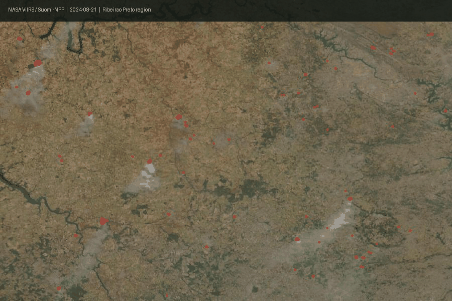
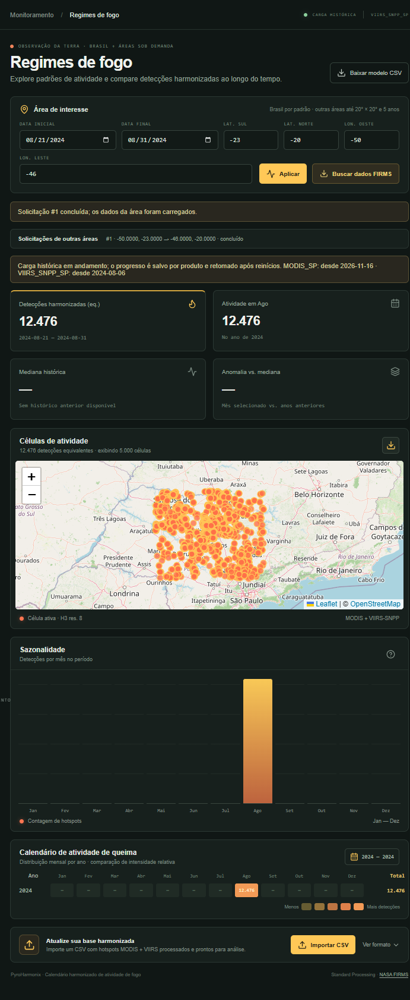

# PyroHarmonix

**Um calendário WebGIS de atividade de fogo no Brasil, com observações MODIS e VIIRS harmonizadas.**

O PyroHarmonix foi desenvolvido para apoiar a leitura de padrões sazonais e mudanças na atividade de fogo. A pessoa seleciona uma área e um período, explora focos detectados por satélite e compara a atividade com anos anteriores.

> **Protótipo científico:** a contagem harmonizada é exploratória e não é uma estimativa de área queimada, uma previsão de incêndios ou um produto validado para decisão operacional.

## Caso real: incêndios no interior de São Paulo em 2024

Em agosto e setembro de 2024, incêndios afetaram municípios do entorno de Ribeirão Preto. Segundo dados do BDQueimadas/INPE publicados pelo g1, entre 21 de agosto e 7 de setembro, seis das dez cidades paulistas com mais focos ficavam na região; Altinópolis e Pitangueiras lideravam o ranking. As dez cidades somaram 651 focos no período.

### Imagem de satélite e focos térmicos


*NASA Worldview/GIBS, 24 ago. 2024. Composição VIIRS/Suomi-NPP em cor verdadeira com anomalias térmicas VIIRS de 375 m. O recorte cobre a região de Ribeirão Preto; os realces são detecções de anomalias térmicas, não perímetros de queimadas.*

### Evolução diária observada pelo satélite



*Animação montada pelo projeto a partir de 11 imagens diárias do NASA Worldview/GIBS, uma por dia entre 21 e 31 ago. 2024. Imagens: VIIRS/Suomi-NPP em cor verdadeira; camada de anomalias térmicas VIIRS de 375 m. As nuvens podem encobrir focos e diferenças de observação entre dias não significam necessariamente que o fogo começou ou terminou naquele instante.*

**Fontes do caso:** [g1 Ribeirão Preto — seis das dez cidades com mais focos eram da região](https://g1.globo.com/sp/ribeirao-preto-franca/noticia/2024/09/09/incendios-em-sp-6-das-10-cidades-com-mais-focos-sao-da-regiao-de-ribeirao-preto.ghtml) · [NASA Earthdata — fumaça de incêndios no Brasil e Bolívia, observada em 28 ago. 2024](https://www.earthdata.nasa.gov/news/worldview-image-archive/thick-smoke-from-fires-brazil-bolivia) · [Abrir NASA Worldview](https://worldview.earthdata.nasa.gov/).

**Atribuição das imagens:** reconhecemos o uso de imagens fornecidas pelos serviços NASA Global Imagery Browse Services (GIBS), parte do NASA Earth Science Data and Information System (ESDIS). As imagens acima são exemplos de contexto e **ainda não são uma camada de imagens integrada ao mapa interativo do PyroHarmonix**.

## O que o WebGIS oferece

- Mapa interativo dos focos agregados em células H3/dia.
- Filtros de período e área por coordenadas.
- Calendário mensal e gráfico de sazonalidade.
- Comparação da atividade do mês selecionado com a mediana histórica.
- Exportação CSV dos resultados filtrados.
- Solicitação de coleta FIRMS para outra área, dentro dos limites descritos abaixo.
- Upload de CSV harmonizado externo.

O mapa interativo usa OpenStreetMap como fundo e mostra as células de atividade detectadas. Ele **não exibe atualmente imagens de satélite como a composição acima nem calcula cicatrizes/áreas queimadas**.

### Exemplo do WebGIS com dados reais: Ribeirão Preto, agosto de 2024



*Captura real da aplicação após concluir a solicitação FIRMS da área (`-50,-23,-46,-20`) para 21–31 ago. 2024. A consulta retornou **12.476 detecções equivalentes**; o mapa exibe até 5.000 células. A mediana histórica está vazia porque esta busca contém somente esse intervalo de 2024.*


*No calendário, o valor de agosto corresponde apenas aos dias selecionados (21–31), não ao mês inteiro. Na captura, o backfill nacional ainda estava em andamento e os registros aparecem como **não calibrados**; portanto, trate os números como uma demonstração exploratória, não como comparação científica final ou orientação operacional.*

## Executar com Docker

Requisitos: Docker Desktop e Docker Compose v2. A chave NASA FIRMS é gratuita; mantenha-a somente no arquivo local `.env`, nunca em `.env.example` ou no Git.

No PowerShell, na pasta do projeto:

```powershell
Copy-Item .env.example .env
notepad .env
```

Edite `FIRMS_MAP_KEY` no `.env` com sua chave obtida em <https://firms.modaps.eosdis.nasa.gov/api/area/>. Depois inicie os serviços:

```powershell
docker compose up -d --build
```

- WebGIS: <http://localhost:8081> (ou a porta definida por `WEB_PORT`).
- Saúde da API: <http://localhost:8081/api/health/>.
- Estado e progresso da coleta: <http://localhost:8081/api/ingestion-status/>.
- Logs do worker: `docker compose logs -f firms-sync`.

O PostgreSQL e o worker rodam em containers. Dados e checkpoints ficam no volume Docker; reiniciar os serviços não apaga a coleta. **Não use `docker compose down -v`** se quiser preservar os dados.

Sem uma chave configurada, a interface continua disponível e o worker informa que está aguardando a chave. Depois de alterar `.env`, recrie o worker para atualizar a variável:

```powershell
docker compose up -d --build --force-recreate firms-sync
```

## Coleta automática e escolha de outras áreas

A coleta contínua está limitada ao Brasil, usando o retângulo FIRMS `-74,-34,-34,6`. O worker carrega os últimos cinco anos de MODIS e VIIRS-SNPP, guarda o progresso por produto e retoma do checkpoint após reinícios. Depois da carga inicial, consulta diariamente os cinco dias mais recentes para incorporar revisões do Standard Processing.

Para pesquisar outra região, informe as datas e o retângulo pelas coordenadas no painel e selecione **Buscar dados FIRMS**. Os pedidos são colocados numa fila persistente e processados pelo worker. Limites atuais:

- Até 20° de largura e 20° de altura por área.
- Datas dentro da janela dos últimos cinco anos; máximo de cinco anos por pedido.
- Até cinco pedidos pendentes na fila.
- Requisições de no máximo cinco dias, com pausa entre chamadas.

O limite de cinco anos reduz armazenamento, mas não garante por si só que o banco caiba em qualquer disco: o tamanho varia com a atividade de fogo e com as áreas solicitadas. Acompanhe espaço livre e o tamanho do banco. Para pausar sem apagar os dados, execute `docker compose stop firms-sync`; para retomar, `docker compose start firms-sync`.

## Dados e harmonização

Produtos Standard Processing da NASA FIRMS:

- `MODIS_SP` (Terra/Aqua; cobertura iniciada em 2000, mas a coleta automática desta instalação é limitada aos últimos cinco anos).
- `VIIRS_SNPP_SP` (Suomi-NPP; série disponível a partir de 2012).

O pipeline:

1. Armazena as detecções originais e atributos FIRMS no PostgreSQL.
2. Agrupa as detecções por célula H3 de resolução 8 (aproximadamente 1 km², variando geograficamente) e dia UTC.
3. Calcula fatores MODIS/VIIRS por mês do ano a partir das observações sobrepostas carregadas no Brasil, se cada produto tiver pelo menos 500 detecções naquele mês.
4. Quando ambos os sensores têm registros na mesma célula/dia, calcula a média entre a contagem MODIS e a contagem VIIRS ajustada. Se apenas um sensor tem registros, usa a contagem disponível, ajustada quando aplicável.

Essa razão mensal agregada para a área de estudo é uma **calibração empírica exploratória**, não uma harmonização científica validada. A detecção de anomalia térmica não identifica sozinha a causa do fogo nem mede a área queimada. Os dados brutos permanecem armazenados para possibilitar reprocessamento. Esta versão não inclui VIIRS NOAA-20/21, produtos NRT, mascaramento de nuvens, estratificação por bioma ou validação independente.

O serviço FIRMS limita a consulta a cinco dias e documenta até 5.000 transações por intervalo de dez minutos; consultas mais longas podem consumir mais de uma transação. O worker mantém pausas e checkpoints, mas a chave é compartilhada com qualquer outro uso da mesma MAP_KEY.

## Importar dados harmonizados por CSV

O upload manual continua disponível para conjuntos harmonizados externos. O modelo pode ser baixado no aplicativo ou em <http://localhost:8081/api/template.csv>.

| Coluna | Obrigatória | Descrição |
| --- | --- | --- |
| `latitude` | Sim | Latitude decimal de -90 a 90 |
| `longitude` | Sim | Longitude decimal de -180 a 180 |
| `acq_datetime` | Sim* | Data/hora ISO 8601, por exemplo `2024-08-12T03:00:00Z` |
| `acq_date` | Sim* | Data `AAAA-MM-DD`, alternativa a `acq_datetime` |
| `acq_time` | Não | Hora `HH:MM` quando se usa `acq_date` |
| `sensor` | Não | Sensor ou origem |
| `confidence` | Não | Confiança fornecida pelo produto |
| `frp` | Não | Potência radiativa do fogo, valor não negativo |

Cada linha representa uma detecção com peso 1. Importações são aditivas; duplicados são ignorados. Arquivos UTF-8 têm limite de 10 MB e 200.000 linhas.

## API

- `GET /api/health/` — saúde do serviço.
- `GET /api/ingestion-status/` — estado do worker e checkpoints por produto.
- `GET /api/area-requests/` — últimas solicitações de área e seus estados.
- `POST /api/area-requests/create/` — solicitar coleta para uma área e período.
- `GET /api/analytics/` — totais, calendário mensal e comparação histórica.
- `GET /api/hotspots/` — células para o mapa; até 10.000 marcadores.
- `GET /api/hotspots.csv` — exportação CSV em streaming.
- `GET /api/template.csv` — modelo para upload.
- `POST /api/upload/` — importar CSV multipart usando o campo `file`.

Endpoints analíticos aceitam `start`, `end`, `south`, `north`, `west` e `east`. A comparação histórica inclui anos sem detecções como zeros; para períodos parciais no mês final, compara a mesma janela de dias nos anos anteriores.

## Desenvolvimento local

Backend (Python 3.12+):

```powershell
cd backend
python -m venv .venv
.\.venv\Scripts\Activate.ps1
pip install -r requirements.txt
python manage.py migrate
python manage.py test
python manage.py runserver
```

Frontend (Node.js 22+), em outro terminal:

```powershell
cd frontend
npm ci
npm run dev
```

## Referências e créditos

- [NASA FIRMS — Area API](https://firms.modaps.eosdis.nasa.gov/api/area/).
- [NASA Earthdata — NASA Worldview](https://www.earthdata.nasa.gov/data/tools/worldview).
- [NASA Earthdata — Global Imagery Browse Services (GIBS)](https://www.earthdata.nasa.gov/engage/open-data-services-software/earthdata-developer-portal/gibs-api).
- [NASA Worldview Snapshots](https://wvs.earthdata.nasa.gov/).
- [INPE — BDQueimadas](https://data.inpe.br/queimadas/bdqueimadas/).
- [g1 — incêndios em SP e municípios da região de Ribeirão Preto, 2024](https://g1.globo.com/sp/ribeirao-preto-franca/noticia/2024/09/09/incendios-em-sp-6-das-10-cidades-com-mais-focos-sao-da-regiao-de-ribeirao-preto.ghtml).

## Escopo e limitações

Calendários e medianas são descrições de contagens, não previsões. O aplicativo depende de internet para o mapa-base OpenStreetMap e para consultas à NASA durante a ingestão. Para implantação pública, configure `DJANGO_SECRET_KEY`, `POSTGRES_PASSWORD`, `DJANGO_DEBUG=false`, hosts permitidos, autenticação no upload e um servidor de aplicação de produção.
