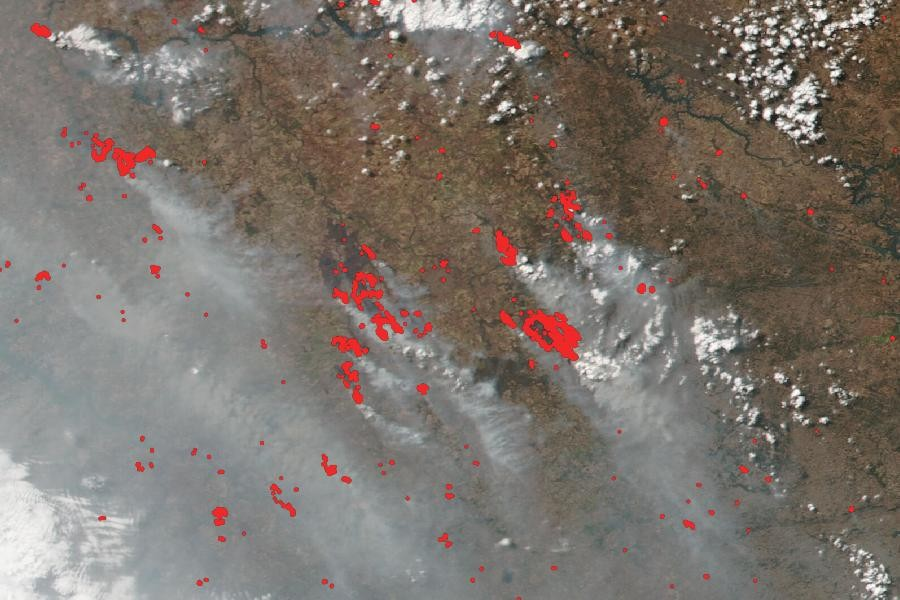

# PyroHarmonix

**Um calendário WebGIS de atividade de fogo para qualquer região, com observações NASA FIRMS MODIS e VIIRS.**

O PyroHarmonix combina Django, React e Docker para apoiar a leitura de padrões sazonais e mudanças na atividade de fogo. Selecione uma área e um ano, processe observações FIRMS já armazenadas ou solicite novos dados; explore o mapa, o calendário e compare a atividade com anos anteriores.

[Apresentação para submissão (PDF, 7 slides)](docs/pyroharmonix-spaceapps-demo.pdf) · [CSV harmonizado de demonstração](docs/data/ribeirao-preto-2024-harmonized-snapshot.csv)

> **Protótipo científico:** contagens e calibração são exploratórias e não representam área queimada, previsão de incêndios ou produto validado para decisão operacional. Resultados refletem somente os dados presentes no banco; ausência de pontos não significa ausência de fogo.

## Caso real: incêndios no interior de São Paulo em 2024

Em agosto e setembro de 2024, incêndios afetaram municípios do entorno de Ribeirão Preto. Segundo dados do BDQueimadas/INPE publicados pelo g1, entre 21 de agosto e 7 de setembro, seis das dez cidades paulistas com mais focos ficavam na região; Altinópolis e Pitangueiras lideravam o ranking. As dez cidades somaram 651 focos no período.

### Imagem de satélite e focos térmicos



*NASA Worldview/GIBS, 24 ago. 2024. Composição VIIRS/Suomi-NPP em cor verdadeira com anomalias térmicas VIIRS de 375 m. O recorte cobre a região de Ribeirão Preto; os realces são detecções de anomalias térmicas, não perímetros de queimadas.*

### Evolução diária observada pelo satélite


*Animação montada pelo projeto a partir de 11 imagens diárias do NASA Worldview/GIBS, uma por dia entre 21 e 31 ago. 2024. Imagens: VIIRS/Suomi-NPP em cor verdadeira; camada de anomalias térmicas VIIRS de 375 m. As nuvens podem encobrir focos e diferenças de observação entre dias não significam necessariamente que o fogo começou ou terminou naquele instante.*

**Fontes do caso:** [g1 Ribeirão Preto — seis das dez cidades com mais focos eram da região](https://g1.globo.com/sp/ribeirao-preto-franca/noticia/2024/09/09/incendios-em-sp-6-das-10-cidades-com-mais-focos-sao-da-regiao-de-ribeirao-preto.ghtml) · [NASA Earthdata — fumaça de incêndios no Brasil e Bolívia, observada em 28 ago. 2024](https://www.earthdata.nasa.gov/news/worldview-image-archive/thick-smoke-from-fires-brazil-bolivia) · [Abrir NASA Worldview](https://worldview.earthdata.nasa.gov/).

**Atribuição das imagens:** reconhecemos o uso de imagens fornecidas pelos serviços NASA Global Imagery Browse Services (GIBS), parte do NASA Earth Science Data and Information System (ESDIS). As imagens acima são exemplos de contexto e **ainda não são uma camada de imagens integrada ao mapa interativo do PyroHarmonix**.

## O que o WebGIS oferece

- Mapa interativo dos focos agregados em células H3/dia.
- Filtros de período e área por coordenadas.
- Calendário mensal e gráfico de sazonalidade.
- Comparação da atividade do mês selecionado com a mediana histórica.
- Exportação CSV dos resultados filtrados.
- Processamento, sem chamadas externas, de dados brutos que já estejam armazenados para uma região e ano.
- Solicitação sob demanda de novos dados FIRMS para uma região e ano, com estimativa do número de chamadas e do tempo de coleta.
- Upload de CSV harmonizado externo.

O mapa interativo usa OpenStreetMap como fundo e mostra as células de atividade detectadas. Ele **não exibe atualmente imagens de satélite como a composição acima nem calcula cicatrizes/áreas queimadas**.

### Snapshot de dados para reprodução

O repositório inclui um [CSV harmonizado de Ribeirão Preto para 2024](docs/data/ribeirao-preto-2024-harmonized-snapshot.csv), exportado da base local. Ele contém 7.747 registros por célula H3/dia, somando 12.535 detecções equivalentes. As datas com registros estão entre 1º de janeiro e 19 de fevereiro e entre 21 e 31 de agosto de 2024; isso não significa cobertura contínua nesses intervalos. A coleta anual foi interrompida antes do fim. Datas sem registros no CSV não demonstram ausência de incêndios. Todos os registros estão marcados como não calibrados. Use-o para reproduzir o mapa e o calendário, não como série completa ou produto operacional.

### Como o projeto responde ao desafio

| Necessidade | Implementação e limite atual |
| --- | --- |
| Série histórica MODIS e continuidade VIIRS | Consulta os produtos FIRMS Standard Processing `MODIS_SP` e `VIIRS_SNPP_SP`, respeitando as datas de início de cada produto. |
| Região e período escolhidos pelo usuário | Retângulo por coordenadas, um ano por solicitação e área máxima de 20° × 20°. Pode ser usado em qualquer país. |
| Calendário de atividade de fogo | Agrega detecções por célula H3 e dia; mostra totais mensais, sazonalidade e comparação com a mediana dos anos disponíveis. |
| Explorar padrões/anomalias | Compara com a mediana histórica da mesma janela quando há pelo menos dois anos anteriores com registros; não é alerta, previsão nem teste estatístico. |
| Baixar os dados da busca | Exporta os focos exibidos em CSV. |
| Harmonizar sensores | Calcula uma calibração empírica por mês quando há amostra suficiente. Enquanto não houver calibração disponível, os resultados são marcados como não calibrados e devem ser interpretados com cautela. |

### Exemplo do WebGIS com dados reais: Ribeirão Preto, agosto de 2024


*Captura real da aplicação filtrada para 2024 na área `-50,-23,-46,-20`. A base local contém **12.535 detecções equivalentes** em registros de janeiro–fevereiro e 21–31 de agosto; o mapa exibe até 5.000 células. A coleta anual foi cancelada antes de terminar. Meses sem registros no painel não devem ser interpretados como meses sem fogo.*


*O valor de agosto corresponde à solicitação concluída para 21–31 ago. 2024, não ao mês inteiro. O CSV de demonstração [`docs/data/ribeirao-preto-2024-harmonized-snapshot.csv`](docs/data/ribeirao-preto-2024-harmonized-snapshot.csv) contém 7.747 registros H3/dia, todos marcados como **não calibrados**. É uma amostra dos dados efetivamente armazenados, não uma cobertura completa do ano.*

## Executar com Docker

Requisitos: Docker Desktop e Docker Compose v2. A chave NASA FIRMS é gratuita; mantenha-a somente no arquivo local `.env`, nunca em `.env.example` ou no Git.

No PowerShell, na pasta do projeto:

```powershell
Copy-Item .env.example .env
notepad .env
```

Edite `FIRMS_MAP_KEY` no `.env` com sua chave obtida em <https://firms.modaps.eosdis.nasa.gov/api/area/>. Depois inicie os serviços:

```powershell
docker compose up -d --build
```

- WebGIS: <http://localhost:8081> (ou a porta definida por `WEB_PORT`).
- Saúde da API: <http://localhost:8081/api/health/>.
- Estado e progresso da coleta: <http://localhost:8081/api/ingestion-status/>.
- Logs do worker: `docker compose logs -f firms-sync`.

O PostgreSQL e o worker rodam em containers. Dados e checkpoints ficam no volume Docker; reiniciar os serviços não apaga a coleta. **Não use `docker compose down -v`** se quiser preservar os dados.

Sem uma chave configurada, a interface continua disponível e o worker informa que está aguardando a chave. Depois de alterar `.env`, recrie o worker para atualizar a variável:

```powershell
docker compose up -d --build --force-recreate firms-sync
```

## Processar dados existentes ou buscar outra região

No painel, escolha um ano e informe o retângulo da área. Há duas ações:

1. **Processar dados existentes** reagrupa somente as detecções FIRMS já presentes no banco para a área e o ano escolhidos. Não consulta a NASA nem consome transações da API. É a opção para analisar dados que já foram baixados anteriormente.
2. **Baixar + analisar** solicita os produtos disponíveis para aquela região e ano, depois os agrega e harmoniza. A fila é persistente e o worker retoma o progresso após reinícios.

O mapa, o calendário, as medianas e o CSV consultam os resultados harmonizados armazenados. Uma região/ano sem dados locais pode aparecer vazia no primeiro modo; use **Baixar + analisar** para buscar os registros. A instalação inicial pode começar sem dados; as capturas deste README documentam uma consulta real feita durante o desenvolvimento.

Limites atuais:

- Até 20° de largura e 20° de altura por área; para regiões maiores, divida a busca em retângulos.
- Um ano por solicitação. São aceitos os anos de 2000 até o ano atual; MODIS começa em 1º de novembro de 2000.
- Até cinco solicitações pendentes ou em processamento.
- A FIRMS é consultada em intervalos de até cinco dias, com pausa entre chamadas e checkpoint.
- O botão **Baixar + analisar** mostra uma faixa heurística de duração. Ela estima 60–180 segundos por chamada, ajustados pela raiz quadrada da área em graus² em relação a 12°². Densidade de focos, rede, resposta FIRMS e desempenho do disco podem aumentar o tempo. A estimativa não inclui processamento local nem prevê o tamanho final do banco.

O backfill nacional contínuo do Brasil está **desativado por padrão** (`FIRMS_BRAZIL_BACKFILL_ENABLED=false`) para evitar downloads e uso de disco não solicitados. A coleta sob demanda funciona para outras áreas e países. Para optar pelo backfill do Brasil, defina `FIRMS_BRAZIL_BACKFILL_ENABLED=true` no `.env` e recrie o serviço `firms-sync`; isso pode consumir bastante armazenamento e tempo. Os dados e checkpoints existentes são preservados. Acompanhe o espaço livre. Para pausar sem apagar os dados, use `docker compose stop firms-sync`; retome com `docker compose start firms-sync`. **Não use `docker compose down -v`** se quiser manter o volume PostgreSQL.

## Dados e harmonização

Produtos Standard Processing da NASA FIRMS:

- `MODIS_SP` (Terra/Aqua; cobertura desde 1º nov. 2000).
- `VIIRS_SNPP_SP` (Suomi-NPP; cobertura desde 20 jan. 2012).

O pipeline:

1. Armazena as detecções originais e atributos FIRMS no PostgreSQL.
2. Agrupa as detecções por célula H3 de resolução 8 (aproximadamente 1 km², variando geograficamente) e dia UTC.
3. Quando uma calibração está disponível, ajusta a contagem VIIRS por mês do ano; cada produto precisa ter pelo menos 500 detecções naquele mês de calibração.
4. Quando ambos os sensores têm registros na mesma célula/dia, calcula a média entre a contagem MODIS e a contagem VIIRS ajustada. Se apenas um sensor tem registros, usa a contagem disponível, ajustada quando aplicável. Sem calibração disponível, mantém o fator neutro e marca os resultados como não calibrados.

### Como MODIS e VIIRS são harmonizados

O objetivo é transformar as contagens dos dois sensores numa série de células H3/dia que possa alimentar o mesmo mapa e calendário:

1. As detecções FIRMS originais são guardadas com a identificação do produto (`MODIS_SP` ou `VIIRS_SNPP_SP`), horário, coordenadas e atributos. Essa origem não é apagada: os registros brutos continuam disponíveis para auditoria e reprocessamento.
2. Cada detecção é atribuída a uma célula H3 de resolução 8 e a um dia UTC. O sistema conta separadamente os registros MODIS e VIIRS em cada célula/dia.
3. Quando existe uma calibração mensal, calcula-se `fator = total MODIS / total VIIRS` para aquele mês e aplica-se o fator à contagem VIIRS. A calibração implementada usa a área de estudo do Brasil e a janela histórica configurada; só é considerada calibrada quando ambos os produtos têm pelo menos 500 registros no mês.
4. Se há contagens dos dois sensores na mesma célula/dia, o valor combinado é a média entre a contagem MODIS e a contagem VIIRS ajustada. Se só um sensor tem registros, usa-se a contagem disponível, com o ajuste VIIRS quando houver fator calibrado.
5. O resultado é gravado como uma observação harmonizada (`MODIS+VIIRS-SNPP`) por célula/dia. O mapa e as análises usam essa série combinada, em vez de apresentar duas séries independentes por sensor.

**Limites importantes:** este é um método empírico exploratório, não uma harmonização científica validada. O fator é agregado para o Brasil e não é recalculado por região, bioma ou área solicitada; aplicá-lo em outra parte do mundo pode não compensar diferenças locais entre sensores. A coleta sob demanda não calcula calibração usando uma amostra parcial. Como o backfill nacional está desativado por padrão, os dados podem permanecer com fator neutro e estado **não calibrado**. Portanto, a origem deixa de ser separada na visualização, mas não deve ser considerada irrelevante na interpretação científica. A detecção de anomalia térmica também não identifica sozinha a causa do fogo nem mede a área queimada. Esta versão não inclui VIIRS NOAA-20/21, produtos NRT, mascaramento de nuvens, estratificação por bioma ou validação independente.

### Por que a mediana histórica pode aparecer como “—”?

A mediana e a anomalia só são calculadas quando há dados harmonizados para o período atual e registros em pelo menos **dois anos históricos** na mesma janela de mês/dias. Períodos sem registros não são mais convertidos automaticamente em zeros, porque podem significar que os dados ainda não foram coletados ou processados. Por isso, “—” significa histórico insuficiente, não ausência de incêndios.

Na região do exemplo, a base demonstrada contém a busca de **21–31 de agosto de 2024**; ela não basta para calcular uma mediana de vários anos. Para obter comparação, processe os dados existentes ou baixe e analise, para a mesma área, outros anos que incluam o mês/período desejado. A anomalia é `(observado − mediana) / mediana × 100` e permanece indisponível quando não há mediana confiável. No calendário, `—` e no gráfico, ausência de focos registrados indicam falta de registros armazenados, não provam que não houve fogo e podem refletir cobertura incompleta.

O serviço FIRMS limita a consulta a cinco dias e documenta até 5.000 transações por intervalo de dez minutos; consultas mais longas consomem chamadas adicionais. A estimativa de chamadas não é uma garantia de limite ou duração. O worker mantém pausas e checkpoints, mas a chave é compartilhada com qualquer outro uso da mesma MAP_KEY.

## Importar dados harmonizados por CSV

O upload manual continua disponível para conjuntos harmonizados externos. O modelo pode ser baixado pelo botão **Baixar modelo CSV** no aplicativo ou no endpoint `/api/template.csv` da instalação local.

| Coluna | Obrigatória | Descrição |
| --- | --- | --- |
| `latitude` | Sim | Latitude decimal de -90 a 90 |
| `longitude` | Sim | Longitude decimal de -180 a 180 |
| `acq_datetime` | Sim* | Data/hora ISO 8601, por exemplo `2024-08-12T03:00:00Z` |
| `acq_date` | Sim* | Data `AAAA-MM-DD`, alternativa a `acq_datetime` |
| `acq_time` | Não | Hora `HH:MM` quando se usa `acq_date` |
| `sensor` | Não | Sensor ou origem |
| `confidence` | Não | Confiança fornecida pelo produto |
| `frp` | Não | Potência radiativa do fogo, valor não negativo |

Cada linha representa uma detecção com peso 1. Importações são aditivas; duplicados são ignorados. Arquivos UTF-8 têm limite de 10 MB e 200.000 linhas.

## API

- `GET /api/health/` — saúde do serviço.
- `GET /api/ingestion-status/` — estado do worker e checkpoints por produto.
- `GET /api/area-requests/` — últimas solicitações de área e seus estados.
- `GET /api/area-requests/estimate/?year=2024&south=-23&north=-20&west=-50&east=-46` — estimar chamadas e duração da coleta.
- `POST /api/area-requests/create/` — processar dados armazenados ou solicitar coleta. Envie `year`, `south`, `north`, `west`, `east` e `download_sources` (`false` para somente dados locais, `true` para baixar e analisar).
- `GET /api/analytics/` — totais, calendário mensal e comparação histórica.
- `GET /api/hotspots/` — células para o mapa; até 10.000 marcadores.
- `GET /api/hotspots.csv` — exportação CSV em streaming.
- `GET /api/template.csv` — modelo para upload.
- `POST /api/upload/` — importar CSV multipart usando o campo `file`.

Endpoints analíticos aceitam `start`, `end`, `south`, `north`, `west` e `east`. A comparação usa os anos anteriores com registros na mesma janela do mês final; exige ao menos dois anos históricos. Períodos sem registros não são assumidos como zeros, pois a cobertura pode estar incompleta.

## Desenvolvimento local

Backend (Python 3.12+):

```powershell
cd backend
python -m venv .venv
.\.venv\Scripts\Activate.ps1
pip install -r requirements.txt
python manage.py migrate
python manage.py test
python manage.py runserver
```

Frontend (Node.js 22+), em outro terminal:

```powershell
cd frontend
npm ci
npm run dev
```

## Referências e créditos

- [NASA FIRMS — Area API](https://firms.modaps.eosdis.nasa.gov/api/area/).
- [NASA FIRMS — dados de incêndios ativos](https://firms.modaps.eosdis.nasa.gov/).
- [NASA Earthdata — NASA Worldview](https://www.earthdata.nasa.gov/data/tools/worldview).
- [NASA Earthdata — Global Imagery Browse Services (GIBS)](https://www.earthdata.nasa.gov/engage/open-data-services-software/earthdata-developer-portal/gibs-api).
- [NASA Worldview Snapshots](https://wvs.earthdata.nasa.gov/).
- [INPE — BDQueimadas](https://data.inpe.br/queimadas/bdqueimadas/).
- [g1 — incêndios em SP e municípios da região de Ribeirão Preto, 2024](https://g1.globo.com/sp/ribeirao-preto-franca/noticia/2024/09/09/incendios-em-sp-6-das-10-cidades-com-mais-focos-sao-da-regiao-de-ribeirao-preto.ghtml).
- [OpenStreetMap — direitos autorais e atribuição](https://www.openstreetmap.org/copyright), usado como mapa-base.
- Tecnologias: [Django](https://www.djangoproject.com/), [React](https://react.dev/), [PostgreSQL](https://www.postgresql.org/), [Docker](https://www.docker.com/), [H3](https://h3geo.org/) e [Leaflet](https://leafletjs.com/).

## Uso de ferramentas de inteligência artificial

Um assistente de IA foi utilizado como apoio à implementação e depuração de código, à revisão da documentação e à preparação dos textos de apresentação. O código e os textos foram revisados pela equipe. As imagens de satélite e os focos térmicos são dados/imagens do NASA Worldview/GIBS, com atribuição indicada acima; não foram gerados por IA. Nenhum áudio ou vídeo gerado por IA foi incluído.

## Escopo e limitações

Calendários e medianas são descrições de contagens, não previsões. Dados MODIS e VIIRS não são diretamente equivalentes; o resultado só deve ser tratado como harmonizado quando a calibração estiver disponível e validada. A cobertura armazenada depende das solicitações feitas e pode ser incompleta, inclusive dentro do ano selecionado. O aplicativo depende de internet para o mapa-base OpenStreetMap e para novos downloads FIRMS. Para implantação pública, configure `DJANGO_SECRET_KEY`, `POSTGRES_PASSWORD`, `DJANGO_DEBUG=false`, hosts permitidos, autenticação no upload e um servidor de aplicação de produção.
