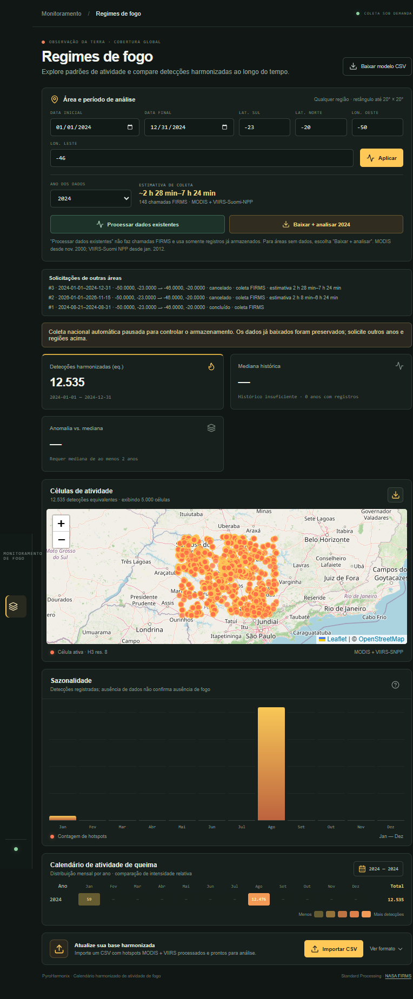
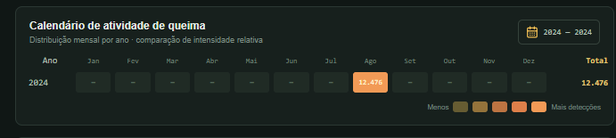

# PyroHarmonix

**A WebGIS calendar for fire activity in any region, using NASA FIRMS MODIS and VIIRS observations.**

PyroHarmonix combines Django, React, and Docker to support reading seasonal patterns and changes in fire activity. Select an area and year, process FIRMS observations already stored in the database or request new data, and explore the map, calendar, and compare the activity with previous years.

[Archived submission presentation (PDF, 7 slides)](docs/pyroharmonix-spaceapps-demo.pdf) · [Legacy Ribeirão Preto CSV](docs/data/ribeirao-preto-2024-harmonized-snapshot.csv)

> **Scientific prototype:** counts and calibration are exploratory and do not represent burned area, fire prediction, or a validated product for operational decision-making. Results reflect only the data currently in the database; the absence of points does not mean no fire occurred.

## NASA Space Apps Challenge 2026 — Ribeirão Preto

PyroHarmonix was developed by team **ThermalGrid** for the **NASA Space Apps Challenge 2026 (Ribeirão Preto local stage)**, finishing in **6th place** among **22 participating teams** based on NASA's official judging criteria (Impact, Creativity, Validity, Relevance, and Presentation).


*NASA Space Apps Challenge Ribeirão Preto 2026 — local judging final classification (`@nasa_spaceapps_ribeirao`), with PyroHarmonix (team ThermalGrid) in 6th place.*


*NASA Space Apps Challenge Ribeirão Preto 2026 — official recognition of all 22 participating teams, including ThermalGrid.*

## Real-world case: fires in inland São Paulo in 2024

In August and September 2024, fires affected municipalities around Ribeirão Preto. According to BDQueimadas/INPE data published by g1, between August 21 and September 7, six of the ten São Paulo cities with the most fire detections were in the region; Altinópolis and Pitangueiras led the ranking. The ten cities totaled 651 detections in the period.

### Satellite image and thermal hotspots


*NASA Worldview/GIBS, August 24, 2024. True-color VIIRS/Suomi-NPP composite with VIIRS thermal anomalies at 375 m. The crop covers the Ribeirão Preto region; the highlighted areas are thermal anomaly detections, not burn perimeters.*

### Daily evolution observed by satellite


*Animation assembled by the project from 11 daily NASA Worldview/GIBS images, one per day between August 21 and 31, 2024. Images: VIIRS/Suomi-NPP in true color; VIIRS thermal anomaly layer at 375 m. Clouds can obscure hotspots, and differences in observation between days do not necessarily mean the fire began or ended at that instant.*

**Case sources:** [g1 Ribeirão Preto — six of the ten cities with the most hotspots were in the region](https://g1.globo.com/sp/ribeirao-preto-franca/noticia/2024/09/09/incendios-em-sp-6-das-10-cidades-com-mais-focos-sao-da-regiao-de-ribeirao-preto.ghtml) · [NASA Earthdata — smoke from fires in Brazil and Bolivia, observed on August 28, 2024](https://www.earthdata.nasa.gov/news/worldview-image-archive/thick-smoke-from-fires-brazil-bolivia) · [Open NASA Worldview](https://worldview.earthdata.nasa.gov/).

**Image attribution:** We acknowledge the use of images provided by the NASA Global Imagery Browse Services (GIBS), part of the NASA Earth Science Data and Information System (ESDIS). The still image and animation are available in the WebGIS image viewer as contextual references; they are **not georeferenced layers overlaid on the interactive map**.

## Scientific audit

The current series uses a detection-conditioned estimator. An unmatched detection keeps its recorded Aqua count or its factor-adjusted VIIRS count. Two detections in the same H3 cell, UTC day and known day/night class are averaged on the Aqua scale. A missing FIRMS row leaves coverage unknown. Existing derived records retain a historical label until rebuilt.

[Technical audit](docs/TECHNICAL_AUDIT.md) · [Scientific methodology](docs/SCIENTIFIC_METHODOLOGY.md) · [Validation report and reproduction commands](docs/VALIDATION_REPORT.md) · [Improvement roadmap](docs/IMPROVEMENT_ROADMAP.md)

The second-stage study quantified positive-detection selection, reproduced the 49.2% difference against Aqua and extended the year-held-out comparison to recorded union totals. It retains the regional method as a descriptive index. [Fusion bias](docs/FUSION_BIAS_ANALYSIS.md) · [Model comparison](docs/MODEL_COMPARISON_REPORT.md) · [Coverage pilot](docs/OBSERVATION_COVERAGE_STUDY.md) · [External validation protocol](docs/EXTERNAL_VALIDATION_PROTOCOL.md)

## What the WebGIS offers

- Interactive map of hotspots aggregated by H3 cell/day.
- Filters for period and area by coordinates.
- Monthly calendar and seasonality chart.
- Comparison of the selected month’s activity with the historical median.
- Regional MODIS-Aqua/VIIRS-SNPP calibration factors for counts and FRP, with bootstrap intervals and a fusion-method comparison.
- Contextual viewer for the 2024 satellite image and daily fire animation.
- CSV export for filtered results.
- Processing, without external calls, of raw FIRMS data already stored for a given region and year.
- On-demand requests for new FIRMS data for a region and year, including estimated number of calls and collection time.
- Upload of external harmonized CSV data.

The interactive map uses OpenStreetMap as the basemap and shows the detected activity cells. The historical image viewer is separate from the map: it does not align imagery with map coordinates or filters, and PyroHarmonix **does not calculate scars/burned areas**.

### Data snapshot for reproduction

**Legacy dataset — not comparable to Aqua-eq:** the repository retains an older [Ribeirão Preto 2024 CSV](docs/data/ribeirao-preto-2024-harmonized-snapshot.csv), exported before the Aqua-eq update. It contains 7,747 H3 res. 8 cell/day records and is uncalibrated; dates with records are intermittent and the annual collection was interrupted. The CSV and the Ribeirão Preto screenshots below are archival examples of the former series, not current WebGIS results. They are retained for historical reproduction only, not as a complete time series or operational product.

The [Altinópolis–Pitangueiras 2024 export](docs/data/altinopolis-pitangueiras-2024-harmonized.csv), [2019–2024 series](docs/data/altinopolis-pitangueiras-2019-2024-harmonized.csv), and [2022–2024 subset](docs/data/altinopolis-pitangueiras-2022-2024-harmonized.csv) archive the historical zero-filled H3 res. 7 series. Their `harmonized_count` values preserve the fractional weights, so summing that column gives the series totals. The exports contain 859 records / 682.01 equivalent detections in 2024, 2,750 records / 1,497.10 detections for 2019–2024, and 1,254 records / 797.80 detections for 2022–2024. The annual totals in the six-year export are 123.18 (2019), 266.94 (2020), 309.18 (2021), 71.25 (2022), 44.54 (2023), and 682.01 (2024). These are totals of records currently in the local database, not proof of complete annual coverage.

The archived [August 21–31, 2024 export](docs/data/current-window-harmonized.csv) contains 411 H3 res. 7 cell/day records totaling 450.16 equivalent detections. The database has automated Hotspots for all five historical years in that window. Their median is 9.964, interquartile range 6.257–12.228, and the 2024 value ranks `1 de 6` with a `ratio_to_historical_max` of 6.37 (`450.162 / 70.665`); because the historical median is below 30, `anomaly_reliable` is `false` and `anomaly_percent` is `null`. Exact year-by-year harmonized values and raw `MODIS-Aqua` / `VIIRS-SNPP` detection counts are in the [series summary](docs/data/series-summary.json). The scale decrease from the legacy res. 8 series reflects Aqua-eq calibration/fusion and the coarser H3 grid, not evidence of less fire. These series are not like-for-like and do not establish a change in fire activity. The separate [calibration sensitivity summary](docs/data/calibration-summary.md) reports count-only diagnostics; FRP is not independently validated.

### How the project addresses the challenge

| Need | Current implementation and limitation |
| --- | --- |
| MODIS historical series and VIIRS continuity | Queries the FIRMS Standard Processing products `MODIS_SP` and `VIIRS_SNPP_SP`, respecting each product’s start date. |
| User-selected region and period | Rectangular area by coordinates, one year per request, and a maximum area of 20° × 20°. It can be used anywhere in the world. |
| Fire activity calendar | Aggregates detections by H3 cell and day; shows monthly totals, seasonality, and comparison with the median of available years. |
| Explore patterns/anomalies | Compares with the historical median of the same window when there are at least two previous years with records; it is not an alert, forecast, or statistical test. |
| Download the search data | Exports the displayed hotspots to CSV. |
| Harmonize sensors | Uses a regional, exploratory MODIS-Aqua/VIIRS-SNPP calibration for the Altinópolis–Pitangueiras sample; it is not applied outside that scope. |

### Regional calibration (experimental)

See the [scientific methodology](docs/SCIENTIFIC_METHODOLOGY.md) for the Altinópolis–Pitangueiras scope, the 2019–2024 assessment interval, H3 cell boundaries and factor estimation. The reported annual ratios and historical monthly errors are reproducible. The historical 38.03% fusion MAPE follows algebraically from averaging the target Aqua measurement with the VIIRS estimate. The holdout comparison evaluates VIIRS alone against Aqua detections recorded in the held-out year. See the [validation report](docs/VALIDATION_REPORT.md) for results by fold and scale and for the 2024 event sensitivity.

Use `validate_calibration` for the historical method comparison and `audit_science` for the expanded analysis. `rebuild_harmonized --start YYYY-MM-DD --end YYYY-MM-DD` reconstructs automated records with the current estimator from stored detections. Use a disposable database to reproduce the scientific reports and review results before rebuilding your application database.

### Example of the WebGIS with real data: Ribeirão Preto, August 2024



*LEGACY capture (H3 res. 8, uncalibrated): filtered for 2024 in the area `-50,-23,-46,-20`. Its stored counts and incomplete collection predate Aqua-eq and are not comparable with the current series. The map displays up to 5,000 cells. Months without records should not be interpreted as months without fire.*



*LEGACY capture (H3 res. 8, uncalibrated): the displayed window is August 21–31, 2024, not the entire month. Its accompanying [Ribeirão Preto CSV](docs/data/ribeirao-preto-2024-harmonized-snapshot.csv) is an archival sample, not the current Aqua-eq series or complete annual coverage.*

## Run with Docker

Requirements: Docker Desktop and Docker Compose v2. The NASA FIRMS key is free; keep it only in the local `.env` file, never in `.env.example` or in Git.

In PowerShell, in the project folder:

```powershell
Copy-Item .env.example .env
notepad .env
```

Edit `FIRMS_MAP_KEY` in `.env` with your key from <https://firms.modaps.eosdis.nasa.gov/api/area/>. Then start the services:

```powershell
docker compose up -d --build
```

- WebGIS: <http://localhost:8081> (or the port defined by `WEB_PORT`).
- API health: <http://localhost:8081/api/health/>.
- Regional calibration factors and fusion totals: <http://localhost:8081/api/calibration/>.
- Collection status and progress: <http://localhost:8081/api/ingestion-status/>.
- Worker logs: `docker compose logs -f firms-sync`.

PostgreSQL and the worker run in containers. Data and checkpoints stay in the Docker volume; restarting the services does not delete the collection. **Do not use `docker compose down -v`** if you want to preserve the data.

Without a configured key, the interface remains available and the worker reports that it is waiting for the key. After changing `.env`, recreate the worker to update the variable:

```powershell
docker compose up -d --build --force-recreate firms-sync
```

## Process existing data or search another region

In the dashboard, choose a year and provide the area rectangle. There are two actions:

1. **Process existing data** re-aggregates only FIRMS detections already present in the database for the selected area and year. It does not query NASA and does not consume API transactions. This is the option for analyzing data that was downloaded previously.
2. **Download + analyze** requests the available products for that region and year, then aggregates and harmonizes them. The queue is persistent and the worker resumes progress after restarts.

The map, calendar, medians, and CSV all consult the harmonized results stored in the database. A region/year with no local data may appear empty in the first mode; use **Download + analyze** to fetch the records. The initial installation may start without data; the screenshots in this README document a real query made during development.

Current limits:

- Up to 20° in width and 20° in height per area; for larger regions, split the search into rectangles.
- One year per request. Years from 2000 to the current year are accepted; MODIS starts on November 1, 2000.
- Up to five pending or processing requests.
- FIRMS is queried in intervals of up to five days, with pauses between calls and checkpoints.
- The **Download + analyze** button shows a heuristic duration range. It estimates 60–180 seconds per call, adjusted by the square root of the area in degrees² relative to 12°². Fire density, network, FIRMS response, and disk performance can increase the time. The estimate does not include local processing and does not predict the final database size.

The continuous national backfill for Brazil is **disabled by default** (`FIRMS_BRAZIL_BACKFILL_ENABLED=false`) to avoid unsolicited downloads and disk usage. On-demand collection works for other areas and countries. To opt into Brazil backfill, set `FIRMS_BRAZIL_BACKFILL_ENABLED=true` in `.env` and recreate the `firms-sync` service; this can consume substantial storage and time. Existing data and checkpoints are preserved. Monitor available disk space. To pause without deleting data, use `docker compose stop firms-sync`; resume with `docker compose start firms-sync`. **Do not use `docker compose down -v`** if you want to keep the PostgreSQL volume.

## Data and harmonization

NASA FIRMS Standard Processing products:

- `MODIS_SP` (Terra/Aqua; coverage from November 1, 2000).
- `VIIRS_SNPP_SP` (Suomi-NPP; coverage from January 20, 2012).

The pipeline:

1. Stores raw FIRMS detections and attributes in PostgreSQL. The Compose worker archives validated CSV responses by SHA-256 in the firms_raw volume.
2. Stores detections at H3 resolution 8 and aggregates into resolution 7 parents by UTC date and day/night class for calibration and harmonized output.
3. In the Altinópolis–Pitangueiras scope, applies the monthly MODIS-Aqua / VIIRS-SNPP factor to VIIRS counts and FRP when regional calibration is available.
4. Uses the mean of observed Aqua and adjusted VIIRS within the same eligible stratum, or the single recorded measurement when only one eligible sensor detected. Outside the regional rectangle, the comparable series uses Aqua observations.
5. Exposes provenance for observed, adjusted, fused, mixed, extrapolated, historical and external records. Results outside 2019–2024 that use a regional VIIRS factor are temporal extrapolations.

NASA FIRMS announced the end of S-NPP delivery on November 2, 2026. The pipeline stops planning new SNPP acquisitions from that date. Standard Processing files may appear after acquisition. The worker checks the published archive limits and reports partial requests when some requested dates are still outside those limits. [NASA FIRMS notices](https://firms.modaps.eosdis.nasa.gov/content/notifications/firms/news.html)

### Why the historical median may appear as “—”

The median and anomaly are calculated only when there are harmonized data for the current period and records in at least **two historical years** in the same month/day window. Periods without records are no longer automatically converted to zeros because they may indicate that data has not yet been collected or processed. Therefore, “—” means insufficient history, not an absence of fire.

In the example region, the demonstration database contains the request for **August 21–31, 2024**; that is not enough to calculate a multi-year median. To obtain a comparison, process existing data or download and analyze for the same area other years that include the desired month/period. The percentage anomaly `(observed − median) / median × 100` is reported only when at least two historical years are available and `historical_median >= 30` (`anomaly_reliable: true`); when the median is below 30 (such as `9.964` in the August 21–31 regional window), `anomaly_reliable` is `false` and `anomaly_percent` is `null` (displayed as `—`), while the historical percentile and `ratio_to_historical_max` remain available where computable. In the calendar, `—` and in the chart, an absence of recorded hotspots indicates missing stored records, not proof that no fire occurred, and may reflect incomplete coverage.

The FIRMS service limits queries to five days and documents up to 5,000 transactions per ten-minute interval; longer queries consume additional calls. The call estimate is not a guarantee of limits or duration. The worker maintains pauses and checkpoints, but the key is shared with any other use of the same MAP_KEY.

## Import harmonized data by CSV

Manual upload remains available for external harmonized datasets. The template can be downloaded via the **Download CSV Template** button in the application or via the `/api/template.csv` endpoint of the local installation.

| Column | Required | Description |
| --- | --- | --- |
| `latitude` | Yes | Decimal latitude from -90 to 90 |
| `longitude` | Yes | Decimal longitude from -180 to 180 |
| `acq_datetime` | Yes* | ISO 8601 date/time, for example `2024-08-12T03:00:00Z` |
| `acq_date` | Yes* | Date `YYYY-MM-DD`, alternative to `acq_datetime` |
| `acq_time` | No | Time `HH:MM` when using `acq_date` |
| `sensor` | No | Sensor or source |
| `confidence` | No | Confidence provided by the product |
| `frp` | No | Fire radiative power, non-negative value |
| `harmonized_count` | No | Non-negative weight for an aggregated hotspot; omitted means `1` |

Each row represents one detection by default. `harmonized_count` is optional and lets an exported aggregate preserve its count weight. Imports are additive; duplicates are ignored. UTF-8 files have a 10 MB limit and 200,000 rows.

## API

- `GET /api/health/` — service health.
- `GET /api/calibration/` — regional count and FRP factors, fusion totals, and calibration scope.
- `GET /api/ingestion-status/` — worker status and checkpoints per product.
- `GET /api/area-requests/` — recent area requests and their states.
- `GET /api/area-requests/estimate/?year=2024&south=-23&north=-20&west=-50&east=-46` — estimate calls and collection duration.
- `POST /api/area-requests/create/` — process stored data or request collection. Send `year`, `south`, `north`, `west`, `east`, and `download_sources` (`false` for local data only, `true` for download and analyze).
- `GET /api/analytics/` — totals, monthly calendar, and historical comparison.
- `GET /api/hotspots/` — cells for the map; up to 10,000 markers.
- `GET /api/hotspots.csv` — streaming CSV export.
- `GET /api/template.csv` — template for upload.
- `POST /api/upload/` — import multipart CSV using the `file` field.

The map and analytics return a null total for empty selections and report coverage as unknown. An explicit recorded zero is numeric. Historical comparisons use the same estimate generation regime. Analytical endpoints accept `start`, `end`, `south`, `north`, `west`, and `east`. The comparison uses previous years with records in the same window as the final month and requires at least two historical years. Periods without records are not assumed to be zero because coverage may be incomplete.

## Local development

Backend (Python 3.12+):

```powershell
cd backend
python -m venv .venv
.\.venv\Scripts\Activate.ps1
pip install -r requirements.txt
python manage.py migrate
python manage.py test
python manage.py runserver
```

Frontend (Node.js 22+), in another terminal:

```powershell
cd frontend
npm ci
npm run dev
```

## References and credits

- [NASA FIRMS — Area API](https://firms.modaps.eosdis.nasa.gov/api/area/).
- [NASA FIRMS — active fire data](https://firms.modaps.eosdis.nasa.gov/).
- [NASA Earthdata — NASA Worldview](https://www.earthdata.nasa.gov/data/tools/worldview).
- [NASA Earthdata — Global Imagery Browse Services (GIBS)](https://www.earthdata.nasa.gov/engage/open-data-services-software/earthdata-developer-portal/gibs-api).
- [NASA Worldview Snapshots](https://wvs.earthdata.nasa.gov/).
- [INPE — BDQueimadas](https://data.inpe.br/queimadas/bdqueimadas/).
- [g1 — fires in SP and municipalities around Ribeirão Preto, 2024](https://g1.globo.com/sp/ribeirao-preto-franca/noticia/2024/09/09/incendios-em-sp-6-das-10-cidades-com-mais-focos-sao-da-regiao-de-ribeirao-preto.ghtml).
- [OpenStreetMap — copyright and attribution](https://www.openstreetmap.org/copyright), used as the basemap.
- Technologies: [Django](https://www.djangoproject.com/), [React](https://react.dev/), [PostgreSQL](https://www.postgresql.org/), [Docker](https://www.docker.com/), [H3](https://h3geo.org/), and [Leaflet](https://leafletjs.com/).

## Use of AI tools

An AI assistant was used to support implementation and debugging, documentation review, and preparation of presentation text. The code and text were reviewed by the team. The satellite images and thermal hotspots are NASA Worldview/GIBS data/images, with attribution provided above; they were not generated by AI. No AI-generated audio or video was included.

## Scope and limitations

Calendars and medians are summaries of counts, not predictions. The Aqua-equivalent series is experimental and limited to the regional calibration scope; it has not been independently validated. Stored coverage depends on the requests made and may be incomplete, even within the selected year. The application depends on internet access for the OpenStreetMap basemap and for new FIRMS downloads. Compose publishes the WebGIS on localhost by default. For public deployment, configure `DJANGO_SECRET_KEY`, `POSTGRES_PASSWORD`, `DJANGO_DEBUG=false`, allowed hosts, upload authentication, and a production application server.