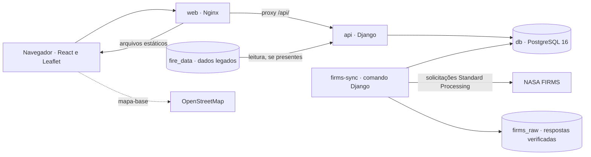
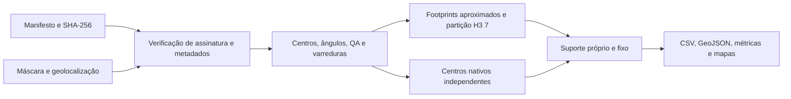

# Arquitetura implementada

## Aplicação e coleta

O Compose publica somente `web`. `api` aplica migrations e trata o legado no startup antes de iniciar o servidor Django de desenvolvimento. A API expõe saúde, calibração, histórico de ingestão, solicitações, hotspots e analytics, importação e exportações CSV. A fila de área/ano e seus checkpoints residem no banco. A ingestão grava centros e atributos brutos e mantém SHA-256 de respostas armazenadas. O agregado/índice vem das observações elegíveis. O pedido de nova coleta e a reanálise de dados locais são operações distintas.

| Camada | Entrada principal | Código |
| --- | --- | --- |
| WebGIS e proxy | Interface, filtros e rotas `/api/` | [App React](../frontend/src/App.jsx) · [Nginx](../frontend/nginx.conf) |
| API e banco | Views, modelos e migrations Django | [Rotas](../backend/api/urls.py) · [Modelos](../backend/api/models.py) |
| Ingestão e harmonização | Fila, CSVs, estratos e índice derivado | [Agendador](../backend/api/management/commands/firms_scheduler.py) · [Serviço FIRMS](../backend/api/services/firms.py) |
| Infraestrutura local | Volumes, ordem de inicialização, publicação do web | [Compose](../docker-compose.yml) |

Os volumes `postgres_data`, `fire_data` e `firms_raw` têm papéis distintos. O backend isolado pode usar SQLite para teste e reprodução. A versão 1.0 é uma aplicação local de pesquisa, com publicação padrão em loopback. Upload e fila são operações de um ambiente local sem fronteira de autenticação de usuários. Um servidor público exigiria outro desenho operacional.

## Ramo científico orbital, isolado

O ramo orbital usa scripts de linha de comando, dependências opcionais e arquivos locais. O resultado experimental alimenta artefatos em disco. A aplicação usa a série operacional por meio dos produtos FIRMS. [Roteiro de reprodução](REPRODUCIBILITY.md) · [Método](METHODOLOGY.md)
