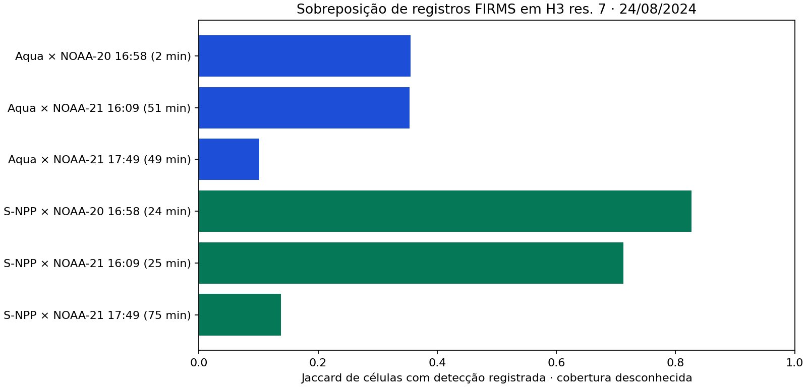

# Fusão condicionada à cobertura válida

## Resultado e recomendação

O piloto processou os quatro grânulos reais de 24/08/2024. O limite angular pré-definido de **55°** deixou Aqua sem área válida na caixa. Assim, as métricas pareadas desse cenário ficaram indefinidas. Os cenários de **60° e 65°** são sensibilidades exploratórias após identificar a limitação angular. O fator VIIRS foi mantido como referência histórica e os métodos de produção permanecem os da fase 2. [Cobertura e procedência](REAL_OBSERVATION_COVERAGE_REPORT.md) · [Baseline da segunda etapa](FUSION_BIAS_ANALYSIS.md)

## Comparação implementada

| Método | Cálculo experimental no conjunto de grânulos |
| --- | --- |
| Aqua observado | Centros nativos de fogo aprovados, atribuídos uma vez pela célula que contém o centro |
| VIIRS bruto | Mesmo critério na resolução nativa de S-NPP |
| VIIRS calibrado | Contagem nativa multiplicada pelo fator mensal da fase 2, com checksum da fonte registrado |
| Zero-filled histórico | Média de Aqua e S-NPP ajustado nos estratos positivos da dupla, com silêncio preenchido por zero aritmético |
| Condicionado aos registros | Média se ambos registram centros de fogo; contribuição integral se só um registra |
| Condicionado à cobertura | Média dos centros Aqua e VIIRS ajustados **na interseção válida, pareada e qualificada por área e tempo** |

A comparação experimental usa contagem de centros nativos e o fator regional histórico, sem reamostrar máscaras em um grid de valores. O fator foi ajustado com o arquivo FIRMS em uma escala diferente de suporte observacional. Seu uso aqui é uma referência comparativa preliminar. Não se aplica calibração nova a FRP nesta etapa.

A interseção deve preencher ao menos 80% da célula de referência na análise principal. Os centros de fogo contam uma vez, inclusive quando o footprint cruza peças de interseção. Verifica-se se o centro nativo está dentro do suporte comum. Um zero significa ausência de detecção naquela parte observada. Células abaixo do limiar ficam nulas para o método de cobertura. A área avaliada pode ser menor que a célula inteira na borda da caixa. Podem ser executados cenários de 60% e 90% com `--minimum-joint-fraction`.

O JSON compara totais das cinco referências na região e nas células elegíveis, apresenta a fusão na área comum e separa células sem positivo, codetecções e registros exclusivos de Aqua ou VIIRS. Uma diferença entre o total nativo e o suporte comum também pode refletir redução de área amostrada. Contadores registram centros de fogo em que o outro sensor classificou o local como terra observada sem fogo. Esses casos permitem investigar a hipótese do silêncio em observação válida. Eles incluem efeitos de horário, footprint, localização de fogo subpixel e limiar do algoritmo. O outro sensor pode ter passado minutos antes ou depois. A decomposição por um dia não quantifica a contribuição causal de cobertura à variação histórica de 49,2%.

## Concordância e fusão no suporte comum observado

| Limite zenital | Células elegíveis | Ambos detectaram | Só Aqua, VIIRS válido | Só VIIRS, Aqua válido | Ambos observaram sem detecção |
| --- | ---: | ---: | ---: | ---: | ---: |
| 55° | 0 | — | — | — | — |
| 60° | 148 | 2 | 1 | 10 | 135 |
| 65° | 910 | 3 | 6 | 19 | 882 |

| Limite zenital | Concordância geral | Jaccard dos positivos | Concordância positiva | Viés S-NPP ajustado − Aqua | MAE | RMSE |
| --- | ---: | ---: | ---: | ---: | ---: | ---: |
| 55° | — | — | — | — | — | — |
| 60° | 92,57% | 15,38% | 26,67% | +0,01097 | 0,04583 | 0,17692 |
| 65° | 97,25% | 10,71% | 19,35% | −0,00106 | 0,01953 | 0,13156 |

A concordância geral inclui as células com ambos os sensores observando sem detecção. O Jaccard divide codetecções pela união dos positivos, e a concordância positiva divide o dobro das codetecções pela soma dos positivos nos dois sensores. O viés, o MAE e o RMSE usam unidades de contagem equivalente a Aqua por célula elegível. Todas as métricas ficam indefinidas no cenário principal de 55°. Os valores são idênticos para 30, 45, 60 e 90 minutos nesta dupla. [Tabela por ângulo e tempo](data/phase3/orbital-2024-08-24/comparacao.csv)

| Limite zenital | Aqua no suporte comum | S-NPP no suporte comum | S-NPP ajustado | Regra de produção no mesmo suporte | Fusão condicionada à cobertura |
| --- | ---: | ---: | ---: | ---: | ---: |
| 55° | — | — | — | — | — |
| 60° | 3 | 22 | 4,62 | 6,41 | 3,81 |
| 65° | 10 | 43 | 9,04 | 16,72 | 9,52 |

A regra de produção foi reaplicada às contagens orbitais e ao fator de calibração histórico. Isso permite comparar as duas regras sobre os mesmos centros de fogo, em equivalentes a Aqua. A 65°, incorporar os zeros observados reduziu a estimativa de **16,72 para 9,52**, uma diferença de **43,1%** dentro do suporte comum. [Gráfico 55°](assets/orbital-fusion-comparison-z55.png) · [Gráfico 60°](assets/orbital-fusion-comparison-z60.png) · [Gráfico 65°](assets/orbital-fusion-comparison-z65.png)

Na região inteira a 65°, a regra condicionada aos registros somou 41,13 equivalentes. A diferença de **31,61** até os 9,52 experimentais se divide em **24,01** por excluir células abaixo de 80% de suporte comum, **0,39** por restringir os centros à interseção dentro dessas células e **7,20** por usar zeros observados. Os dois recortes de disponibilidade somam **77,2%** dessa redução aritmética do total fundido nesta dupla. A 60° os três componentes foram 13,74, 0,39 e 2,60 equivalentes, respectivamente. [Decomposição a 60°](data/phase3/orbital-2024-08-24/summary-z60.json) · [Decomposição a 65°](data/phase3/orbital-2024-08-24/summary-z65.json)

Quando avaliados somente no suporte comum a 65°, S-NPP registrou 43 centros de fogo e Aqua, 10. Após a calibração histórica, a diferença agregada S-NPP menos Aqua foi −0,96 equivalente. Também houve 35 centros S-NPP em área classificada por Aqua como terra sem detecção e 10 centros Aqua em área classificada assim por S-NPP. A disponibilidade é mensurável nesta dupla, e as detecções exclusivas sob cobertura válida mostram que persistem diferenças de observação. Geometria, resolução, QA e o intervalo de cerca de 26 minutos também podem influenciar essa comparação. A contribuição causal da disponibilidade para a diferença histórica de 49,2% permanece indeterminada. Estes números vêm dos quatro grânulos reais. Os testes com dados sintéticos verificam à parte o comportamento do algoritmo.

## Expansão controlada e fonte externa

- Recomenda-se uma ampliação limitada, mediante autorização. Começar por uma dupla com geometria prevista de até 55° nos dois sensores. Revisar amostras de footprints Aqua e a sensibilidade ao QA M13 de VIIRS, estimar o suporte comum antes de aplicar o limiar de 80% e registrar também os pares sem suporte. Se o piloto ampliado produzir suporte suficiente, planejar uma comparação com referência independente antes de propor mudanças na fusão de produção.
- Definir seis datas candidatas, uma por ano de 2019–2024, com janelas fora de agosto e pares diurno/noturno. Usar atividade registrada apenas para estratificar a seleção de dias altos e baixos. Contabilizar também datas sem aquisição utilizável. A dupla diurna piloto estima cerca de 186 MB e a noturna cerca de 200 MB. Seis pares ficam em cerca de 1,1–1,2 GB. Usar ambos os turnos em seis datas pode passar de 2 GB. Reservar inicialmente 2–3 GiB de RAM por processamento de uma dupla. Medir tempo e pico de memória antes de executar pares em lote. Solicitar autorização antes da expansão.
- NOAA-20 e NOAA-21 são candidatos a **transferência entre plataformas** e concordância entre produtos. O catálogo da segunda etapa já identificou aquisições em 24/08/2024. Para estimar concordância há dependência de suas máscaras, geolocalização e evidência de suporte válido compatível. A confirmação do comportamento de detecção em campo requer uma referência com desenho e cobertura independentes.
- Em MCD64A1, o tile de agosto registrado no protocolo serve para **concordância espacial com um produto derivado em parte de MODIS**. MapBiomas Fogo fornece um desfecho Landsat distinto para associação espacial mensal. O acesso por Range ao link nacional de 2024 candidato retornou 403. A alternativa oficial de recorte usa a plataforma Google Earth Engine. Um raster regional recortado é o insumo indicado para uma futura comparação de presença e área queimada. O ensaio de associação com área queimada aguarda um recorte adequado. [Protocolo externo](EXTERNAL_VALIDATION_PROTOCOL.md) · [Recortes oficiais MapBiomas](https://brasil.mapbiomas.org/downloads/baixe-mapas-recortados-geotiff-via-google-earth-engine/)

## Prova complementar com NOAA-20 e NOAA-21

Executamos duas consultas FIRMS Standard Processing para a mesma caixa e dia. NOAA-20 retornou 636 registros e NOAA-21, 652, incluindo os turnos. O ensaio agrupou as linhas diurnas por horário UTC e célula H3 7 e comparou a interseção e a união dos conjuntos positivos. A cada linha do resultado, um registro exclusivo pode decorrer de cobertura, horário, sensibilidade ou diferença de localização. O denominador do Jaccard é a união de células com detecção registrada. A cobertura dos demais locais permanece desconhecida. [API FIRMS](https://firms.modaps.eosdis.nasa.gov/api/area/) · [Resultados e checksums](data/phase3/noaa-positive-overlap-2024-08-24.json)

| Referência | Comparador UTC | Diferença temporal | Células positivas em comum | Jaccard dos positivos |
| --- | --- | ---: | ---: | ---: |
| Aqua 17:00 | NOAA-20 16:58 | 2 min | 32 | 0,356 |
| Aqua 17:00 | NOAA-21 16:09 | 51 min | 29 | 0,354 |
| Aqua 17:00 | NOAA-21 17:49 | 49 min | 6 | 0,102 |
| S-NPP 16:34 | NOAA-20 16:58 | 24 min | 67 | 0,827 |
| S-NPP 16:34 | NOAA-21 16:09 | 25 min | 57 | 0,713 |
| S-NPP 16:34 | NOAA-21 17:49 | 75 min | 11 | 0,138 |

Com tolerância de 30 min, entram um par de Aqua e dois de S-NPP. A 60 min, entram mais dois de Aqua. A 90 min, entram os seis, inclusive S-NPP ↔ NOAA-21 às 17:49. A sobreposição de S-NPP com NOAA-20 foi maior que a de Aqua com NOAA-20 apesar do maior intervalo. Diferenças de plataforma, resolução, geometria e dinâmica do fogo podem contribuir. Este resultado é descritivo e não estima sensibilidade, especificidade ou acurácia.



Reprodução no worker com a configuração FIRMS já existente. O script registra o SHA-256 das respostas e produz exclusivamente JSON agregado.

```powershell
docker compose run --rm --no-deps -v "${PWD}/backend:/app:ro" -v "${PWD}/docs/data/raw:/raw:ro" -v "${PWD}/docs/data/phase3:/reports" firms-sync python orbital_external.py /raw /reports/noaa-positive-overlap-2024-08-24.json
python backend/plot_orbital_pilot.py docs/assets --external-json docs/data/phase3/noaa-positive-overlap-2024-08-24.json
```
