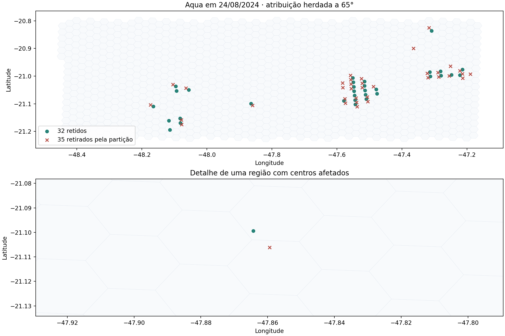

# Auditoria geométrica dos centros Aqua

## Origem dos 35 casos

Em 24/08/2024, a máscara MYD14 continha 67 centros regionais de classes 8 e 9. Com o limite exploratório de 65°, todos passaram pelo filtro de entrada. O cenário herdado contou 32 centros. Os **35 restantes** tinham coordenadas e geolocalização nominais, ficaram na caixa e dentro dos próprios footprints reconstruídos. Todos perderam a propriedade do ponto central para um footprint de ângulo zenital menor, vindo de uma varredura imediatamente adjacente.

| Motivo auditado | Centros entre os 35 |
| --- | ---: |
| Sobreposição com observação prioritária de varredura adjacente | 35 |
| Recorte pela caixa ou célula | 0 |
| Geometria inválida ou vizinhança insuficiente | 0 |
| Centro fora do footprint reconstruído | 0 |
| Reprovação por geolocalização ou QA de entrada | 0 |
| Duplicidade comprovada por identidade de observação | 0 |

Em 22 casos o footprint prioritário também trazia fogo e, em 13, terra válida sem detecção. O footprint prioritário veio da varredura anterior em 19 casos e da seguinte em 16, com intervalos de aproximadamente 1,477 s. As distâncias entre os centros foram de **731 a 1.150 m** e a interseção aproximada entre os dois footprints foi de **3,04 a 4,27 km²**. Os 67 centros ocorreram em posições distintas e foram pareados um a um com 67 registros FIRMS a até 10 m. Essa correspondência confirma a identidade dos registros em relação aos centros da máscara. A tabela exporta o polígono original reconstruído em WKT, em metros na projeção Lambert azimutal equivalente local, e informa o H3 do centro. Uma mesma fonte térmica subpixel pode aparecer em varreduras adjacentes e sua identidade física permanece aberta. [Rastreio por linha e coluna](data/phase4/2024-08-24/centers-aqua-z65-strict.csv) · [Correspondência FIRMS](ORBITAL_CALIBRATION_COMPATIBILITY.md)

## Escala e limites da aproximação

Nos 35 centros afetados, os footprints reconstruídos mediram **3,36 a 4,01 km** na direção transversal, **1,73 a 1,85 km** na direção longitudinal e **5,83 a 7,42 km²** em área. A NASA descreve o crescimento do pixel MODIS nominal de 1 km para cerca de 4,8 km por 2,0 km na borda extrema e a sobreposição entre varreduras adjacentes. O método de meios passos reproduz a escala e permite rastrear a sobreposição. Nos 35 casos, as diferenças absolutas medianas frente a scan e track publicados pelo FIRMS foram de 38 m na transversal e 32 m na longitudinal. Esses campos têm arredondamento ao décimo de quilômetro. Na dupla de 2019, mais perto do nadir, os quatro footprints de fogo Aqua mediram 1,18 a 1,34 km² e os quatro centros foram retidos pelas duas regras. Continua necessária uma checagem independente das bordas, dos ângulos internos, da resposta espacial e dos deslocamentos por relevo. [NASA Dark Target ATBD](https://darktarget.gsfc.nasa.gov/atbd-products) · [Estudo NASA sobre bow-tie MODIS](https://ntrs.nasa.gov/citations/20080045515) · [Diagnóstico numérico](data/phase4/2024-08-24/geometry-and-qa-diagnostics.json)

## Partição de áreas e contagem de detecções

A área válida segue a partição exclusiva da fase 3, com preferência pelo menor ângulo zenital, malha geométrica de 1 cm e classes disjuntas. A contagem experimental usa uma observação por índice nativo, desde que o centro passe pelo QA, tenha tempo utilizável e esteja na célula e no próprio footprint reconstruído. Na análise pareada o centro também precisa pertencer à interseção efetiva de áreas válidas com iluminação compatível e atender à tolerância temporal em relação ao outro sensor. As peças de área pareadas também precisam cumprir a tolerância. Assim, a contagem de centros muda sem alterar a área para um mesmo QA. A revisão preserva as classes de área da observação prioritária, mesmo quando outro centro nativo de fogo cai nessa área.

A regra independente reteve 67 de 67 centros Aqua nesse cenário porque os 67 satisfizeram os critérios. A 55°, nenhum centro passou pelo limite angular nesta dupla. As contagens referem-se a pixels classificados no produto. A validação de focos físicos únicos exigiria uma referência de resolução e co-temporalidade adequadas. Os resultados de 65° continuam exploratórios. [Matriz completa de ângulo, QA, suporte e tempo](data/phase4/2024-08-24/comparison.csv)
