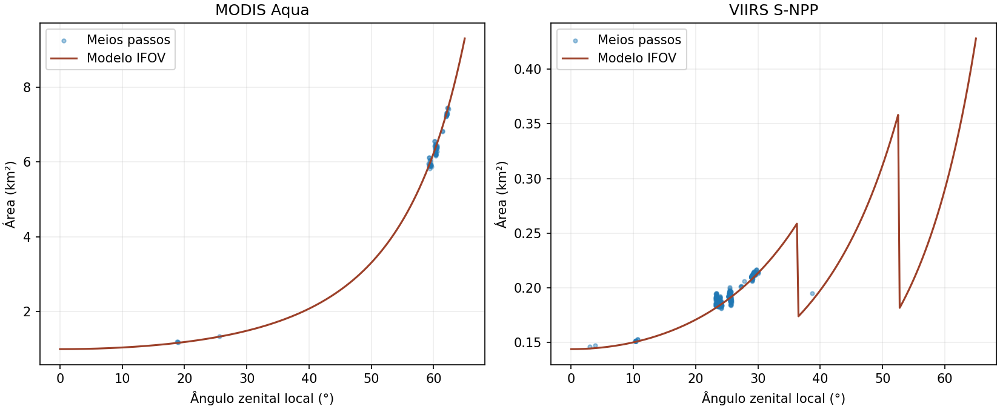

# Referências independentes para a geometria orbital

## O que as referências permitem verificar

| Sensor | Referência instrumental | Comparação possível | Limite |
| --- | --- | --- | --- |
| MODIS Aqua | MYD03 C6.1 fornece centro geodésico, terreno, zenital e azimute, com campos de navegação por varredura. A documentação independente do código do piloto descreve 10 detectores de 1 km e período de varredura de 1,477 s. | Verificar a ordem da dimensão, a direção de ampliação e a sobreposição adjacente. O ATBD Dark Target informa 4,8 × 2,0 km na borda extrema, ante 1 km nominal. | Os centros MYD03 são o insumo do piloto. Concordância com esses centros ou com o tamanho publicado não valida a posição dos quatro cantos. |
| VIIRS S-NPP | VNP03IMG C2 fornece vetores de visada e geolocalização corrigida de terreno, agregação e navegação por varredura. O manual SDR NOAA descreve amostragem, zonas de agregação e descarte bow-tie, com crescimento da escala espacial perto da borda. | Verificar centros, tamanho nominal de 375 m, limiares de descarte, descontinuidade entre zonas e aumento das dimensões. | A largura de amostragem e a resposta ao impulso são conceitos distintos. As dimensões instrumentais não determinam sozinhas a área de um footprint no terreno. |

[Especificação NASA MOD03/MYD03 C6.1](https://ladsweb.modaps.eosdis.nasa.gov/filespec/MODIS/61/MOD03) · [NASA MODIS Dark Target ATBD](https://darktarget.gsfc.nasa.gov/atbd-products) · [NASA MODIS e período de varredura](https://www.earthdata.nasa.gov/s3fs-public/2022-02/MODIS_True_Color.pdf) · [Manual SDR VIIRS NOAA, §2.16.1](https://ncc.nesdis.noaa.gov/documents/documentation/viirs-sdr-dataformat.pdf) · [Guia NASA de nível 1 VIIRS, 2021](https://ladsweb.modaps.eosdis.nasa.gov/api/v2/content/archives/Document%20Archive/Science%20Data%20Product%20Documentation/Processing%20and%20Algorithm%20Version%20History/NASA_VIIRS_L1B_UG_August_2021.pdf)

## Cantos, resposta do pixel e terreno

As especificações consultadas de MYD03 C6.1 e VNP03IMG C2 descrevem coordenadas por centro e geometria de varredura. Não foi localizada, nos quatro produtos autorizados, uma camada de quatro cantos geodésicos independentes para cada pixel de fogo. A reconstrução física requer vetores de visada nas bordas de um detector, navegação e atitude, modelo de terreno e, para VIIRS, composição da agregação. Uma implementação baseada nesses dados seria um método instrumental distinto e exigiria validação em alvos georreferenciados. Uma implementação alternativa dos meios passos entre centros continuaria dependente da mesma aproximação.

A etapa 4 encontrou dimensões Aqua de 3,36–4,01 km por 1,73–1,85 km nos 35 centros afetados, coerentes em ordem de grandeza com o crescimento MODIS fora do nadir. Na geometria de 2019, as áreas dos quatro footprints Aqua foram 1,18–1,34 km², mais próximas da área nominal. As dimensões FIRMS servem de controle de escala e podem compartilhar a geometria ancestral dos produtos. Geolocalização nominal, conservação de área e a proximidade de centros são verificações diferentes. Os footprints permanecem **aproximações experimentais** e o erro absoluto de seus cantos ainda não foi medido. [Medições originais da etapa 4](FOOTPRINT_GEOMETRY_AUDIT.md) · [Análise NASA da sobreposição MODIS](https://ntrs.nasa.gov/citations/20080045515)

## Controle quantitativo da escala instrumental

Derivamos uma referência dimensional com esfera de raio 6.371 km, altitude nominal de 705 km em Aqua e 824 km em S-NPP e dimensão instrumental no nadir. A distância oblíqua é a raiz positiva da interseção entre a linha de visada e a esfera orbital. A dimensão longitudinal cresce com a distância oblíqua. A transversal inclui ainda a inclinação do feixe em relação à superfície. Em VIIRS, aplicamos fatores 3/3, 2/3 e 1/3 na direção transversal nos limites de ângulo de varredura de 31,59° e 44,68°. Usamos 388 × 371 m no nadir conforme a caracterização de S-NPP. O modelo usa ângulos dos grânulos, mas não usa vizinhos do pixel para calcular as dimensões. Portanto, verifica ordem de grandeza e tendência esperada. Ele não verifica o contorno, a posição dos cantos, o efeito de terreno nem a sobreposição área por área. [NOAA VIIRS Imagery ATBD, §3.2.4](https://www.star.nesdis.noaa.gov/jpss/documents/ATBD/D0001-M01-S01-008_JPSS_ATBD_VIIRS-Imagery_E.pdf) · [NASA VIIRS Fire ATBD, figura 1](https://ladsweb.modaps.eosdis.nasa.gov/api/v2/content/archives/Document%20Archive/Science%20Data%20Product%20Documentation/Product%20Generation%20Algorithms/VIIRS_activefire_375m_ATBD.pdf) · [Caracterização S-NPP VIIRS](https://www.mdpi.com/2072-4292/14/14/3367)

A tabela usa centros brutos de fogo com footprint utilizável, inclusive os centros de alto ângulo de 2024, fora do cenário principal. Os pixels com fogo são uma amostra concentrada e podem compartilhar varreduras. [Comparação individual de dimensões](data/phase5/instrument-scale-comparison.csv) · [Resumo da razão de áreas](data/phase5/instrument-scale-summary.json)

A razão mediana entre área reconstruída e área IFOV foi **1,017** em quatro centros Aqua até 30° e **0,993** nos 67 centros Aqua acima de 55°. Em VIIRS, as medianas foram **1,012** em 372 centros até 30° e **1,004** em três centros de 30° a 55°. Os centros estão concentrados na passagem de agosto de 2024. A amostra não permite avaliar os contornos em todas as zonas de agregação. Nas sete duplas, o maior resíduo de fechamento por célula foi **3,80 × 10⁻⁶** da área inteira, dentro da tolerância prévia. O teste comprova consistência numérica da partição, enquanto a validade absoluta dos cantos continua em aberto.
