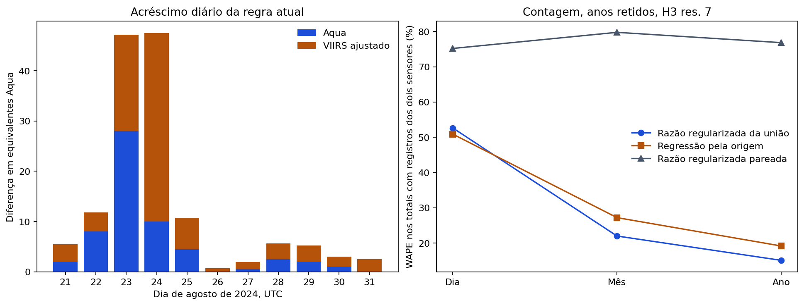

# Viés de seleção na fusão

## Escopo e comparação

O estudo mantém as 9.383 detecções FIRMS regionais de 2019–2024 e o agrupamento da auditoria anterior. Os fatores mensais são ajustados sobre toda a amostra apenas para reproduzir os totais históricos. Esta comparação é descritiva. A análise fora do ano de treino está no [relatório de modelos](MODEL_COMPARISON_REPORT.md).

| Sinal na caixa de calibração, H3 7 | Total | Grandeza |
| --- | ---: | --- |
| Aqua observado | 1.530 | Soma de detecções registradas pelo MODIS-Aqua |
| S-NPP bruto | 7.853 | Soma de detecções registradas pelo VIIRS-SNPP |
| S-NPP ajustado | 1.529,27 | Soma VIIRS ponderada em escala Aqua |
| Média histórica com preenchimento por zero | 1.529,63 | Média aritmética dos totais registrados, usando zero nas posições vazias |
| Média condicionada às detecções | 2.282,55 | Soma das médias com ambos os sensores e das contribuições integrais onde só um registrou |
| Fusão condicionada à cobertura | Indeterminada | Exige informação de observação para determinar se um silêncio representa zero ou falta de cobertura |

A reprodução usa os 3.028 estratos na caixa bruta de calibração. Deles, 533 têm codetecção, 444 têm apenas registro Aqua e 2.051 têm apenas registro S-NPP. O total da fusão condicionada equivale a **1,49186× Aqua**, reproduzindo os **49,2%** da versão anterior. Em relação à fusão histórica, sua diferença é de **752,91 equivalentes Aqua**, ou **49,22%**. O ajuste aproxima os totais marginais de Aqua e VIIRS por construção, uma vez que sua referência anual é a razão de somas. Esse alinhamento da escala tem efeito direto sobre a soma da média histórica.

Para turno conhecido, seja `m` a contagem Aqua registrada e `v*=fv` a contribuição VIIRS ajustada. Nos estratos de codetecção as regras calculam a mesma média. Quando só Aqua registrou, a mudança acrescenta `m/2`. Quando só VIIRS registrou, acrescenta `v*/2`. Assim, na região toda, o acréscimo é `288,50 + 464,41 = 752,91`. Nas amostras os turnos estavam preenchidos. Quando o turno é desconhecido e ambos registram, a implementação atual prioriza Aqua.

Há **seleção pela detecção** no universo analisado e no divisor da média. Se o segundo sensor observou com qualidade e obteve zero, a regra atual superestima a média das duas medições naquele estrato. Se o segundo sensor esteve fora da faixa, sob nuvens ou sem observação válida, dividir a medição existente por dois a reduz por imputação. Os CSVs positivos não permitem estimar a frequência de cada situação nem o viés relativo ao fogo real. A série atual é uma medida de atividade registrada com composição variável de sensores. A versão histórica é uma comparação aritmética de sinais registrados. A série condicionada à cobertura ainda carece de observações de pixels comparáveis. As três têm perguntas diferentes.

## Agosto de 2024

Usou-se a mesma janela de 21–31 de agosto UTC em cada ano e o mesmo filtro do centro da célula H3 7 usado na auditoria. Essa seleção geométrica é mais restrita que a caixa de detecções usada no ajuste. Em 2024, as 411 células-dia continham 489 estratos de dia/noite. O fator de agosto foi 0,21015463.

| Estrato | Quantidade | Histórico | Regra atual | Acréscimo | Fração do acréscimo |
| --- | ---: | ---: | ---: | ---: | ---: |
| Codetecção | 163 | 308,44 | 308,44 | 0,00 | 0% |
| Só Aqua registrou | 80 | 58,50 | 117,00 | 58,50 | 41,28% |
| Só S-NPP registrou | 246 | 83,22 | 166,44 | 83,22 | 58,72% |
| Total | 489 | 450,16 | 591,88 | 141,72 | 100% |

O aumento de **31,48%** é composto por **13,00 pontos percentuais** de Aqua e **18,49 pontos** de S-NPP, com arredondamento. O turno diurno acrescentou **86,97** equivalentes (52,50 Aqua e 34,47 S-NPP), e o noturno **54,76** (6,00 Aqua e 48,76 S-NPP). Os dias 23 e 24 responderam juntos por **66,8%** da diferença. As maiores contribuições por célula foram `87a81a55dffffff` (+3,00), `87a81a442ffffff` (+2,92) e `87a81a44cffffff` (+2,63).

| Dia de agosto | Delta Aqua | Delta S-NPP | Delta total |
| --- | ---: | ---: | ---: |
| 21 | 2,00 | 3,47 | 5,47 |
| 22 | 8,00 | 3,78 | 11,78 |
| 23 | 28,00 | 19,12 | 47,12 |
| 24 | 10,00 | 37,51 | 47,51 |
| 25 | 4,50 | 6,20 | 10,70 |
| 26 | 0,00 | 0,74 | 0,74 |
| 27 | 0,50 | 1,47 | 1,97 |
| 28 | 2,50 | 3,15 | 5,65 |
| 29 | 2,00 | 3,26 | 5,26 |
| 30 | 1,00 | 2,00 | 3,00 |
| 31 | 0,00 | 2,52 | 2,52 |

| Sinal | 2024 | Maior total anterior, 2021 |
| --- | ---: | ---: |
| Aqua observado | 459 | 60 |
| S-NPP bruto | 2.100 | 387 |
| S-NPP ajustado | 441,32 | 81,33 |
| Histórico | 450,16 | 70,66 |
| Regra atual | 591,88 | 106,17 |

O primeiro lugar de 2024 resiste às cinco séries observáveis e ao ajuste sem 2024 da [auditoria anterior](VALIDATION_REPORT.md). Aqua não registrou detecções na janela de 2023, por isso o ranking Aqua considera os cinco anos com valor. O ranking é regional e condicionado ao registro disponível. O resultado para cobertura pareada segue indeterminado.



## Reproduzir

Os artefatos registram o identificador do estudo e a assinatura SHA-256 dos estratos de entrada em resolução 7. [JSON](data/phase2/fusion-study.json) · [CSV por estrato, dia, mês, ano, turno e célula](data/phase2/fusion-scales.csv) · [CSV do evento por dia, turno e célula](data/phase2/fusion-event-2024.csv)

A partir da raiz, em PowerShell com a imagem `api` já construída, use SQLite descartável e uma saída separada dos resultados históricos.

```powershell
docker compose run --rm --no-deps -e DB_ENGINE=sqlite -e DATABASE_PATH=/tmp/study.sqlite3 -v "${PWD}/backend:/app:ro" -v "${PWD}/docs/data:/archive" api sh -c 'set -e; python manage.py migrate --noinput; python manage.py load_firms_sample --path /archive/raw; python manage.py study_fusion --output-dir /archive/phase2'
python docs/plot_fusion_study.py docs/data/phase2 docs/assets/fusion-study.png
```
