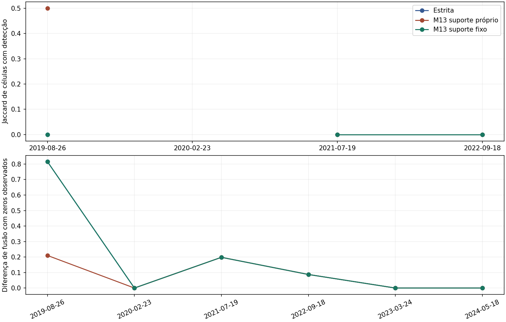

# Robustez das regras de fusão orbital

## Comparação na mesma área e no mesmo horário

Aqua e VIIRS brutos são contagens de centros nativos. O VIIRS calibrado usa o fator mensal FIRMS. A regra condicionada aos registros e a regra condicionada à cobertura usam os mesmos centros, células e interseção temporal. A última usa zero confirmado para a parcela válida quando só um sensor detecta. Valores nulos indicam falta de suporte utilizável. Totais zero podem vir de observação válida sem detecção.

| Data | QA e suporte | Aqua | VIIRS | VIIRS ajustado | Regra de registros | Regra de cobertura | Diferença por zeros observados |
| --- | --- | ---: | ---: | ---: | ---: | ---: | ---: |
| 26/08/2019 | Estrito | 1,00 | 3,00 | 0,63 | 1,63 | 0,82 | 0,82 |
| 26/08/2019 | M13 própria | 3,00 | 7,00 | 1,47 | 2,45 | 2,24 | 0,21 |
| 26/08/2019 | M13 fixa | 1,00 | 3,00 | 0,63 | 1,63 | 0,82 | 0,82 |
| 23/02/2020 | Estrito | 0,00 | 0,00 | 0,00 | 0,00 | 0,00 | 0,00 |
| 23/02/2020 | M13 própria | 0,00 | 0,00 | 0,00 | 0,00 | 0,00 | 0,00 |
| 23/02/2020 | M13 fixa | 0,00 | 0,00 | 0,00 | 0,00 | 0,00 | 0,00 |
| 19/07/2021 | Estrito | 0,00 | 2,00 | 0,40 | 0,40 | 0,20 | 0,20 |
| 19/07/2021 | M13 própria | 0,00 | 2,00 | 0,40 | 0,40 | 0,20 | 0,20 |
| 19/07/2021 | M13 fixa | 0,00 | 2,00 | 0,40 | 0,40 | 0,20 | 0,20 |
| 18/09/2022 | Estrito | 0,00 | 1,00 | 0,17 | 0,17 | 0,09 | 0,09 |
| 18/09/2022 | M13 própria | 0,00 | 1,00 | 0,17 | 0,17 | 0,09 | 0,09 |
| 18/09/2022 | M13 fixa | 0,00 | 1,00 | 0,17 | 0,17 | 0,09 | 0,09 |
| 24/03/2023 | Estrito | 0,00 | 0,00 | 0,00 | 0,00 | 0,00 | 0,00 |
| 24/03/2023 | M13 própria | 0,00 | 0,00 | 0,00 | 0,00 | 0,00 | 0,00 |
| 24/03/2023 | M13 fixa | 0,00 | 0,00 | 0,00 | 0,00 | 0,00 | 0,00 |
| 18/05/2024 | Estrito | 0,00 | 0,00 | 0,00 | 0,00 | 0,00 | 0,00 |
| 18/05/2024 | M13 própria | 0,00 | 0,00 | 0,00 | 0,00 | 0,00 | 0,00 |
| 18/05/2024 | M13 fixa | 0,00 | 0,00 | 0,00 | 0,00 | 0,00 | 0,00 |
| 24/08/2024 | Estrito | — | — | — | — | — | — |
| 24/08/2024 | M13 própria | — | — | — | — | — | — |
| 24/08/2024 | M13 fixa | — | — | — | — | — | — |

A decomposição por política primeiro exclui células abaixo da fração comum, depois restringe os centros à geometria temporalmente válida dentro das células elegíveis e, por fim, reaplica a regra que usa zeros observados. Para comparar QA, acrescente o contraste entre estrita e M13 no suporte fixo, seguido da mudança para o suporte próprio de M13. O fator histórico permanece constante dentro da dupla. A redução da estimativa ao excluir área e incorporar zeros não mede maior acurácia nem explica causalmente a diferença de 49,2% observada na série de atividade registrada.

| Data | QA | Exclusão de células | Recorte dos centros | Zeros observados | Total regional menos fusão experimental |
| --- | --- | ---: | ---: | ---: | ---: |
| 26/08/2019 | Estrito | 1,00 | 1,29 | 0,82 | 3,11 |
| 26/08/2019 | M13 | 0,61 | 0,00 | 0,21 | 0,82 |
| 23/02/2020 | Estrito | 0,00 | 0,00 | 0,00 | 0,00 |
| 23/02/2020 | M13 | 0,00 | 0,00 | 0,00 | 0,00 |
| 19/07/2021 | Estrito | 0,00 | 0,00 | 0,20 | 0,20 |
| 19/07/2021 | M13 | 0,00 | 0,00 | 0,20 | 0,20 |
| 18/09/2022 | Estrito | 0,00 | 0,00 | 0,09 | 0,09 |
| 18/09/2022 | M13 | 0,00 | 0,00 | 0,09 | 0,09 |
| 24/03/2023 | Estrito | 0,00 | 0,00 | 0,00 | 0,00 |
| 24/03/2023 | M13 | 0,00 | 0,00 | 0,00 | 0,00 |
| 18/05/2024 | Estrito | 0,00 | 0,00 | 0,00 | 0,00 |
| 18/05/2024 | M13 | 0,00 | 0,00 | 0,00 | 0,00 |
| 24/08/2024 | Estrito | — | — | — | — |
| 24/08/2024 | M13 | — | — | — | — |

## Recomendação B

Continuar desenvolvendo a fusão condicionada à cobertura em caráter experimental. Usar em produção o índice de atividade registrada existente, com a interpretação já adotada. A amostra diversifica anos, meses e turnos e identifica efeitos de QA e suporte. Os pares informativos continuam raros e o cenário de 55° de 24/08/2024 ficou sem suporte. Isso impede atribuir as diferenças a acurácia ou justificar recalibração mensal ou alteração em produção. Antes de propor uma aquisição maior, usar o plano de validação externa para definir uma evidência independente de presença e reservar blocos para avaliação. [Consolidação da amostra](STRATIFIED_ORBITAL_SAMPLE_REPORT.md) · [Validação externa](EXTERNAL_VALIDATION_PROTOCOL.md)
