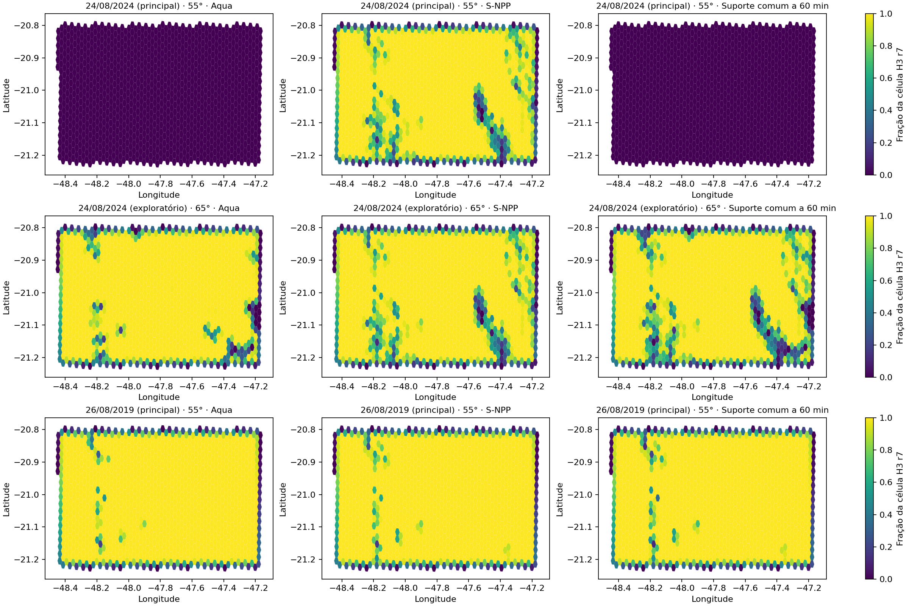
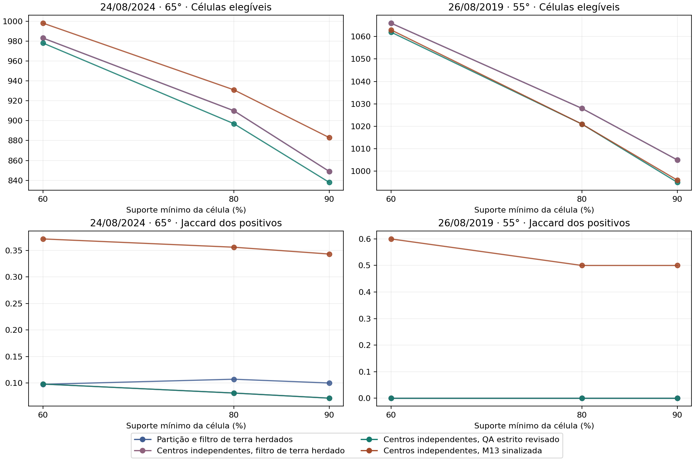

# Segundo piloto orbital em Altinópolis–Pitangueiras

## Seleção e aquisição

A busca no catálogo público CMR cobriu 20 a 27/08/2019, uma janela curta no mesmo período sazonal do piloto de 2024. A seleção comparou aquisições diurnas para manter a iluminação em comum com a primeira dupla. Usamos a contenção da caixa nos polígonos de catálogo, ângulo previsto de até 55° nos dois sensores, diferença nominal de até 30 min e disponibilidade das máscaras e geolocalizações. As alternativas foram ordenadas por menor intervalo nominal e depois por menor ângulo máximo previsto. Nenhum dado de fogo foi usado no ranqueamento. A aproximação angular usou a linha central inferida dos polígonos CMR e altitudes nominais. [API NASA CMR](https://cmr.earthdata.nasa.gov/search/site/docs/search/api.html) · [Candidatas, exclusões e ordem](data/phase4/candidate-selection.json)

A dupla de **26/08/2019** ficou em primeiro lugar, com início nominal às 16:45 UTC para Aqua e às 16:48 UTC para S-NPP. Os ângulos máximos previstos foram 28,83° e 12,29°. A segunda opção elegível, 21/08/2019, tinha intervalo de 12 min e máximo estimado de 53,65° em Aqua. Foram baixados apenas MYD14, MYD03, VNP14IMG e VNP03IMG de 26/08/2019, totalizando **187.476.769 bytes (178,79 MiB)**. As assinaturas, os tamanhos, os SHA-256, os pares de tempo e as grades nativas foram conferidos. [Plano](data/phase4/2019-08-26-granule-plan.json) · [Manifesto verificado](data/phase4/2019-08-26/granule-manifest.json)

| Dupla | Ângulo regional Aqua | Ângulo regional S-NPP | Janela de varredura Aqua UTC | Janela de varredura S-NPP UTC |
| --- | --- | --- | --- | --- |
| 24/08/2024 | 59,03°–63,16° | 22,82°–31,52° | 17:00:28,59–17:00:37,45 | 16:34:45,98–16:34:56,65 |
| 26/08/2019 | 16,81°–27,45° | 1,90°–12,35° | 16:49:09,01–16:49:17,88 | 16:53:29,43–16:53:40,11 |

A separação local em 2019 foi de 4 min 12 s a 4 min 31 s. As duas duplas estão integralmente dentro da menor janela testada quando há suporte espacial comum. As tolerâncias de 30, 45, 60 e 90 min produziram os mesmos resultados em cada combinação de ângulo e QA. [Metadados regionais de 2024](data/phase4/2024-08-24/regional-metadata.json) · [Metadados regionais de 2019](data/phase4/2019-08-26/regional-metadata.json)

## Métodos comparados

O limite principal de 55° e o limiar principal de 80% ficaram fixos. O reprocessamento de 24/08/2024 incluiu 55°, 60° e 65°. Em cada cenário foram avaliados limiares de 60%, 80% e 90% da área inteira da célula H3 7. A área comum da caixa inclui as frações válidas abaixo do limiar. As métricas de concordância e os totais pareados usam somente células que atingem o limiar. Nenhum ajuste de produção foi alterado.

| Cenário no CSV | Tratamento |
| --- | --- |
| Partição e QA herdados | Reconstitui a fase 3 |
| Centros independentes e terra herdada | Isola o efeito de contar centros sem depender da partição |
| Centros independentes, terra corrigida e QA estrito | Isola a correção da máscara terrestre |
| Centros independentes, terra corrigida e M13 sinalizada | Isola a mudança experimental no bit 6 |

As duas regras de fusão são reaplicadas aos mesmos centros que passaram pelo recorte comum. A regra condicionada à cobertura usa zeros em observações válidas. A decomposição também informa separadamente o efeito da exclusão de células abaixo do limiar e o efeito de restringir os centros à interseção dentro das células elegíveis. O fator histórico de agosto é experimental neste domínio. [Auditoria geométrica](FOOTPRINT_GEOMETRY_AUDIT.md) · [QA VIIRS](VIIRS_QA_SENSITIVITY_REPORT.md) · [Compatibilidade da calibração](ORBITAL_CALIBRATION_COMPATIBILITY.md)

## Resultados a 60 minutos e 80% de suporte por célula

As áreas da tabela são regionais. Os centros são as contagens regionais após a atribuição geométrica em cada cenário. Em 2024, as máscaras brutas tinham 67 centros Aqua e 363 VIIRS. Em 2019, tinham 4 Aqua e 9 VIIRS. As colunas de entrada e os motivos de exclusão por centro estão nos arquivos completos.

| Dupla | Ângulo e cenário | Aqua válido (km²) | VIIRS válido (km²) | Suporte comum (km²) | Células elegíveis | Centros Aqua | Centros VIIRS |
| --- | --- | ---: | ---: | ---: | ---: | ---: | ---: |
| 2024 | 55° · Revisão estrita | 0,00 | 5.526,16 | 0,00 | 0 | — | 82 |
| 2024 | 60° · Legado | 1.062,92 | 5.568,57 | 981,88 | 148 | 8 | 80 |
| 2024 | 60° · Revisão estrita | 1.062,92 | 5.526,16 | 981,88 | 148 | 20 | 82 |
| 2024 | 60° · Revisão com M13 sinalizada | 1.062,92 | 5.629,88 | 1.013,23 | 160 | 20 | 347 |
| 2024 | 65° · Legado | 5.627,63 | 5.568,57 | 5.380,48 | 910 | 32 | 80 |
| 2024 | 65° · Só separar centros | 5.627,63 | 5.568,57 | 5.380,48 | 910 | 67 | 83 |
| 2024 | 65° · Revisão estrita | 5.627,63 | 5.526,16 | 5.352,64 | 897 | 67 | 82 |
| 2024 | 65° · Revisão com M13 sinalizada | 5.627,63 | 5.629,88 | 5.456,25 | 931 | 67 | 347 |
| 2019 | 55° · Legado | 5.808,35 | 5.840,66 | 5.801,35 | 1028 | 4 | 3 |
| 2019 | 55° · Só separar centros | 5.808,35 | 5.840,66 | 5.801,35 | 1028 | 4 | 3 |
| 2019 | 55° · Revisão estrita | 5.808,35 | 5.797,95 | 5.778,93 | 1021 | 4 | 3 |
| 2019 | 55° · Revisão com M13 sinalizada | 5.808,35 | 5.800,48 | 5.781,45 | 1021 | 4 | 8 |

A matriz de concordância usa apenas células elegíveis. Os exclusivos têm área válida do outro sensor. O viés é S-NPP ajustado menos Aqua, em equivalentes Aqua por célula elegível. MAE e RMSE têm a mesma unidade.

| Dupla | Ângulo e cenário | Ambos | Só Aqua | Só VIIRS | Ambos sem fogo | Jaccard | Dice/F1 | Kappa | MAE | RMSE | Viés |
| --- | --- | ---: | ---: | ---: | ---: | ---: | ---: | ---: | ---: | ---: | ---: |
| 2024 | 55° · Revisão estrita | — | — | — | — | — | — | — | — | — | — |
| 2024 | 60° · Legado | 2 | 1 | 10 | 135 | 0,1538 | 0,2667 | 0,2421 | 0,0458 | 0,1769 | 0,0110 |
| 2024 | 60° · Revisão estrita | 2 | 4 | 10 | 132 | 0,1250 | 0,2222 | 0,1778 | 0,0864 | 0,3508 | -0,0296 |
| 2024 | 60° · Revisão com M13 sinalizada | 11 | 3 | 16 | 130 | 0,3667 | 0,5366 | 0,4762 | 0,1794 | 0,5095 | 0,0536 |
| 2024 | 65° · Legado | 3 | 6 | 19 | 882 | 0,1071 | 0,1935 | 0,1821 | 0,0195 | 0,1316 | -0,0011 |
| 2024 | 65° · Só separar centros | 3 | 15 | 19 | 873 | 0,0811 | 0,1500 | 0,1311 | 0,0338 | 0,2052 | -0,0153 |
| 2024 | 65° · Revisão estrita | 3 | 15 | 19 | 860 | 0,0811 | 0,1500 | 0,1308 | 0,0343 | 0,2067 | -0,0156 |
| 2024 | 65° · Revisão com M13 sinalizada | 26 | 14 | 33 | 858 | 0,3562 | 0,5253 | 0,4996 | 0,0749 | 0,3198 | 0,0094 |
| 2019 | 55° · Legado | 0 | 1 | 2 | 1025 | 0,0000 | 0,0000 | -0,0013 | 0,0016 | 0,0345 | -0,0004 |
| 2019 | 55° · Só separar centros | 0 | 1 | 2 | 1025 | 0,0000 | 0,0000 | -0,0013 | 0,0016 | 0,0345 | -0,0004 |
| 2019 | 55° · Revisão estrita | 0 | 1 | 2 | 1018 | 0,0000 | 0,0000 | -0,0013 | 0,0016 | 0,0346 | -0,0004 |
| 2019 | 55° · Revisão com M13 sinalizada | 2 | 0 | 2 | 1017 | 0,5000 | 0,6667 | 0,6658 | 0,0023 | 0,0516 | -0,0015 |

| Dupla | Ângulo e cenário | Produção reaplicada no suporte comum | Fusão condicionada à cobertura | Exclusão de células | Recorte interno de centros | Efeito dos zeros observados |
| --- | --- | ---: | ---: | ---: | ---: | ---: |
| 2024 | 55° · Revisão estrita | — | — | — | — | — |
| 2024 | 60° · Legado | 6,41 | 3,81 | 13,74 | 0,39 | 2,60 |
| 2024 | 60° · Revisão estrita | 11,91 | 6,81 | 16,24 | 0,79 | 5,10 |
| 2024 | 60° · Revisão com M13 sinalizada | 34,15 | 24,29 | 44,34 | 0,00 | 9,86 |
| 2024 | 65° · Legado | 16,72 | 9,52 | 24,01 | 0,39 | 7,20 |
| 2024 | 65° · Só separar centros | 29,22 | 16,02 | 40,59 | 0,79 | 13,20 |
| 2024 | 65° · Revisão estrita | 29,22 | 16,02 | 40,38 | 0,79 | 13,20 |
| 2024 | 65° · Revisão com M13 sinalizada | 83,57 | 60,36 | 10,57 | 0,50 | 23,21 |
| 2019 | 55° · Legado | 1,63 | 0,82 | 1,00 | 1,29 | 0,82 |
| 2019 | 55° · Só separar centros | 1,63 | 0,82 | 1,00 | 1,29 | 0,82 |
| 2019 | 55° · Revisão estrita | 1,63 | 0,82 | 1,00 | 1,29 | 0,82 |
| 2019 | 55° · Revisão com M13 sinalizada | 2,45 | 2,24 | 0,61 | 0,00 | 0,21 |

A 65° em 2024, separar os centros elevou a contagem Aqua de 32 para 67 com área comum idêntica à herdada. Corrigir terra depois dessa separação reduziu a área comum de 5.380,48 para 5.352,64 km². A política M13 ampliou o suporte comum para 5.456,25 km². A diferença da regra de fusão sobre os mesmos centros foi de 13,20 equivalentes no QA estrito e de 23,21 com M13 sinalizada. A redução total após recorte combina mudança da área amostrada e mudança da regra.

Em 2019 a 55°, o QA estrito teve 1021 células elegíveis, com três células positivas distribuídas entre os sensores e nenhuma codetecção. Com M13 sinalizada houve 2 codetecções e 2 positivos exclusivos de S-NPP, de modo que o Jaccard foi 0,50. Esse valor depende de apenas 4 células positivas. A contagem Aqua ficou em 4 nos quatro tratamentos. A influência da partição de varreduras sobre os centros, grande em Aqua em 2024 a 65°, foi ausente na amostra Aqua de 2019. A alteração de QA foi relevante nas duas duplas. O ganho de concordância positiva com M13 sinalizada descreve as amostras processadas e não estabelece maior acurácia.

## Sensibilidade ao limiar de área

| Dupla | Ângulo e QA revisado | Elegíveis a 60% / 80% / 90% | Jaccard a 60% / 80% / 90% |
| --- | --- | --- | --- |
| 2024 | 55° · Revisão estrita | 0 / 0 / 0 | — / — / — |
| 2024 | 55° · Revisão com M13 sinalizada | 0 / 0 / 0 | — / — / — |
| 2024 | 60° · Revisão estrita | 179 / 148 / 123 | 0,125 / 0,125 / 0,125 |
| 2024 | 60° · Revisão com M13 sinalizada | 182 / 160 / 146 | 0,355 / 0,367 / 0,321 |
| 2024 | 65° · Revisão estrita | 978 / 897 / 838 | 0,098 / 0,081 / 0,071 |
| 2024 | 65° · Revisão com M13 sinalizada | 998 / 931 / 883 | 0,372 / 0,356 / 0,343 |
| 2019 | 55° · Revisão estrita | 1062 / 1021 / 995 | 0,000 / 0,000 / 0,000 |
| 2019 | 55° · Revisão com M13 sinalizada | 1063 / 1021 / 996 | 0,600 / 0,500 / 0,500 |

Os resultados reproduzem as áreas e a elegibilidade legadas da fase 3. As verificações de conservação cobrem a soma das classes por célula e o limite da interseção pela menor área válida individual, até a tolerância numérica de 2 × 10⁻⁵ da área inteira. As tabelas separam os quatro cenários de QA e contagem em todas as tolerâncias. O SHA-256 do fator histórico é preservado nos JSONs. [CSV de 2024](data/phase4/2024-08-24/comparison.csv) · [JSON de 2024](data/phase4/2024-08-24/comparison.json) · [CSV de 2019](data/phase4/2019-08-26/comparison.csv) · [JSON de 2019](data/phase4/2019-08-26/comparison.json)

A trilha com classes, frações e contagens por célula está disponível em GeoJSON para cada tratamento. Os scripts de análise e geração de figuras usam os manifestos verificados e as mesmas fontes FIRMS locais dos relatórios. [GeoJSON do QA estrito em 2024 a 65°](data/phase4/2024-08-24/cells-z65-independent_strict.geojson.gz) · [GeoJSON do QA estrito em 2019 a 55°](data/phase4/2019-08-26/cells-z55-independent_strict.geojson.gz) · [Processamento](../backend/orbital_phase4.py) · [Figuras](../backend/plot_orbital_phase4.py)

## Recomendação

Manter o limite principal de 55° para o próximo bloco e priorizar pares escolhidos por geometria, intervalo e iluminação antes de consultar as detecções. Uma nova amostra pequena e estratificada, mediante autorização, deve abranger diferentes níveis de atividade, aplicar as duas políticas de presença em paralelo e registrar os pares sem suporte. Antes de expandir para toda a série, verificar a aproximação de footprint com geometria independente, medir o impacto de QA e resolução sobre as contagens e testar a calibração orbital com separação entre ajuste e avaliação. Os resultados de 2019 têm poucos positivos e o par de 2024 precisou de ângulo exploratório para gerar suporte. A estimativa causal para a diferença histórica permanece aberta.

As duas duplas usaram observações reais. Os cinco testes adicionais usam casos controlados para regressão da separação entre área e centros e seu pareamento temporal, filtro terrestre/M13, leitura do bitfield, Kappa e teto de aquisição. A suíte completa passou com **99 testes em PostgreSQL**, sem alterações de migrations.
