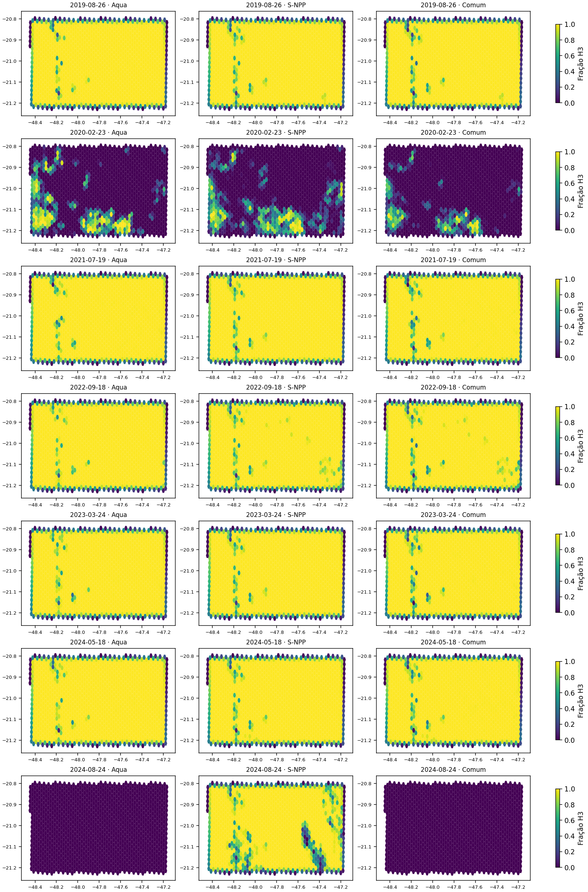

# Amostra orbital estratificada

## Plano de aquisição publicado antes dos downloads

Cinco candidatas satisfizeram os critérios do protocolo. A busca usou somente metadados públicos CMR e contagem de registros FIRMS locais para o estrato de atividade. As duplas novas pertencem a cinco anos, três são diurnas e duas noturnas. A janela noturna de novembro de 2024 ficou sem candidata elegível. [Protocolo prévio](ORBITAL_EXPERIMENT_PROTOCOL.md) · [Inventário completo do plano](data/phase5/sample-plan.json) · [API NASA CMR](https://cmr.earthdata.nasa.gov/search/site/docs/search/api.html)

| Data UTC | Turno | Estação | Atividade (registros FIRMS no turno) | Máximos previstos Aqua / VIIRS | Intervalo nominal | Tamanho de catálogo |
| --- | --- | --- | --- | --- | ---: | ---: |
| 23/02/2020 | Dia | Chuvosa | Baixa (0) | 23,14° / 23,00° | 11 min | 189,25 MiB |
| 19/07/2021 | Noite | Seca | Alta (2) | 47,86° / 20,13° | 25 min | 193,59 MiB |
| 18/09/2022 | Dia | Seca | Intermediária (1) | 20,28° / 42,95° | 2 min | 223,64 MiB |
| 24/03/2023 | Noite | Chuvosa | Baixa (0) | 32,27° / 30,20° | 19 min | 206,33 MiB |
| 18/05/2024 | Dia | Seca | Baixa (0) | 26,43° / 42,97° | 28 min | 218,20 MiB |
| 08–23/11/2024 | Noite | Chuvosa | Alta visada | Sem par elegível | — | — |

A janela seca diurna de 2022 ficou sem par de atividade alta e usou o desvio previsto no protocolo. Em novembro, entre 20 combinações noturnas, 15 excederam o limite angular estimado, 13 excederam o máximo temporal e duas falharam na contenção da caixa. Há sobreposição entre motivos. O catálogo estima **1.031,02 MiB** para 20 grânulos. O teto operacional é de 250 MiB por dupla, abaixo do teto total autorizado mesmo com seis duplas.

## Execução e suporte observado

A aquisição verificou **5 duplas novas** e transferiu **1.081.100.852 bytes (1,007 GiB)** dos 1.610.612.736 bytes autorizados. A execução sequencial usou 7 duplas no conjunto principal incluindo os dois pilotos reutilizados. 6 tiveram suporte no cenário principal com QA estrito. A amostra inclui novos conjuntos diurnos e noturnos. Um dia pode ter cobertura útil mesmo com zero centros de fogo. Em 23/02/2020 a classe de nuvens ocupou aproximadamente 4.962 km² em Aqua e 4.930 km² em VIIRS, restringindo o suporte mesmo com ângulos baixos. [Aquisição](data/phase5/acquisition.json) · [Processamento](data/phase5/processing.json)

| Data | Origem | Turno | Atividade | Ângulo máximo Aqua / VIIRS | Intervalo local (min) | Comum estrito (km²) | Elegíveis 60% / 80% / 90% | Positivas a 80% |
| --- | --- | --- | --- | --- | --- | ---: | --- | ---: |
| 26/08/2019 | Piloto reutilizado | Dia | Alta | 27,45° / 12,35° | 4,19–4,52 | 5.778,93 | 1062/1021/995 | 3 |
| 23/02/2020 | Nova | Dia | Baixa | 24,10° / 23,39° | 8,76–9,11 | 467,43 | 55/23/15 | 0 |
| 19/07/2021 | Nova | Noite | Alta | 47,89° / 19,84° | 26,90–27,22 | 5.772,36 | 1061/1017/991 | 1 |
| 18/09/2022 | Nova | Dia | Intermediária | 20,16° / 42,69° | 1,94–2,29 | 5.759,20 | 1063/1016/984 | 1 |
| 24/03/2023 | Nova | Noite | Baixa | 32,27° / 29,75° | 18,69–19,01 | 5.774,13 | 1063/1020/994 | 0 |
| 18/05/2024 | Nova | Dia | Baixa | 27,22° / 42,76° | 29,61–29,96 | 5.776,87 | 1063/1023/993 | 0 |
| 24/08/2024 | Piloto reutilizado | Dia | Alta | 63,16° / 31,52° | 25,53–25,86 | 0,00 | 0/0/0 | — |

| Data | Tempo Linux | Pico RSS do processo | Arquivos científicos | Resultados locais¹ |
| --- | ---: | ---: | ---: | ---: |
| 26/08/2019 | 79,6 s | 1,43 GiB | 178,79 MiB | 0,54 MiB |
| 23/02/2020 | 66,5 s | 1,40 GiB | 189,25 MiB | 0,50 MiB |
| 19/07/2021 | 72,0 s | 1,43 GiB | 193,59 MiB | 0,53 MiB |
| 18/09/2022 | 68,8 s | 1,44 GiB | 223,64 MiB | 0,53 MiB |
| 24/03/2023 | 67,7 s | 1,40 GiB | 206,33 MiB | 0,51 MiB |
| 18/05/2024 | 67,9 s | 1,40 GiB | 218,20 MiB | 0,51 MiB |
| 24/08/2024 | 60,4 s | 1,42 GiB | 185,54 MiB | 0,98 MiB |

¹ Tamanho na saída da execução, antes de gráficos e agregações. Os valores de RSS são o pico de cada processo no contêiner, não a memória total do host.

As sete duplas tiveram separação máxima regional inferior a 30 min. Os quatro limites de tempo produziram as mesmas métricas em cada combinação de QA e fração, portanto esta amostra informa pouco sobre comparações acima de 30 min. Nas cinco novas duplas, nenhum centro Aqua foi classificado como fogo na caixa e o suporte estrito conteve três centros VIIRS, em duas datas. A janela perdida de novembro também reduziu a representação de alta atividade noturna.

## Descrição por dupla e por células agrupadas

As células da mesma dupla são espacialmente dependentes. As médias abaixo usam uma dupla por linha com métrica definida. Os resultados agrupados recalculam a matriz e os erros usando todas as células elegíveis, dando mais peso a duplas com mais células ou positivos. Uma ausência bilateral de positivos em área observada tem concordância geral 1, mas Jaccard e Dice ficam indefinidos. Não foram produzidos intervalos de confiança baseados em células.

| Suporte | QA | Duplas com suporte | Jaccard médio por dupla (n) | Mediana (mín.–máx.) | Jaccard agrupado | Células positivas agrupadas |
| --- | --- | ---: | --- | --- | ---: | ---: |
| Próprio | Estrito | 6 | 0,000 (3) | 0,000 (0,000–0,000) | 0,000 | 5 |
| Próprio | M13 | 6 | 0,167 (3) | 0,000 (0,000–0,500) | 0,333 | 6 |
| Fixo | Estrito | 6 | 0,000 (3) | 0,000 (0,000–0,000) | 0,000 | 5 |
| Fixo | M13 | 6 | 0,000 (3) | 0,000 (0,000–0,000) | 0,000 | 5 |

As agregações por turno, atividade, estação, classe geométrica e fração mínima estão integralmente no JSON. Os estratos de atividade são relativos ao arquivo FIRMS local. A mediana das quatro distribuições foi zero, e um dia com apenas dois registros foi classificado como alto na estação seca noturna. Os resultados têm poucos positivos, em especial quando se exige suporte fixo. As sensibilidades de 60°/65° para 2024 permanecem nos artefatos da etapa 4. [Estatísticas consolidadas](data/phase5/consolidated.json) · [Métricas por dupla](data/phase5/per-pair-metrics.csv) · [Cenários históricos angulares](SECOND_ORBITAL_PILOT_REPORT.md)

## Reprodução

A seleção em metadados usa o script de plano. A aquisição serial aplica o teto por dupla e o teto total. O processador em Linux verifica o manifesto, lê HDF4/NetCDF, cronometra as duplas sequencialmente e grava métricas e rastreio. As rotinas de resumo e referência instrumental geram figuras e tabelas sem refazer os downloads. Os arquivos científicos brutos ficam em diretório ignorado pelo Git. [Planejamento](../backend/orbital_sample_plan.py) · [Aquisição](../backend/orbital_sample_acquire.py) · [Execução sequencial](../backend/orbital_sample_batch.py) · [Agregação](../backend/orbital_sample_summary.py)

A suíte final passou com **101 testes em PostgreSQL**, incluindo as regressões de suporte fixo e agregação por dupla. A verificação de migrations passou.
