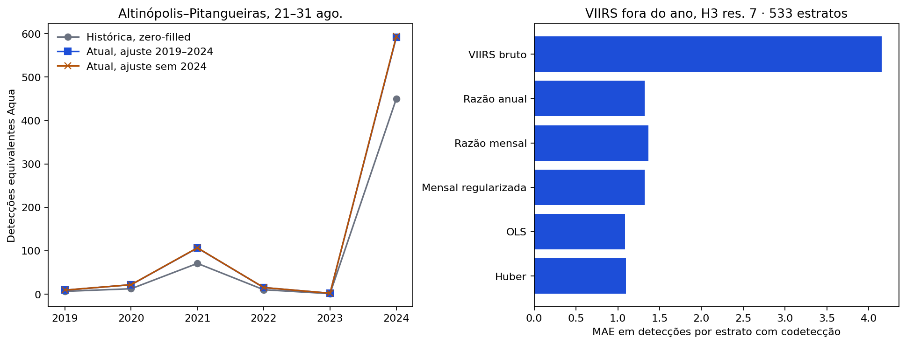

# Relatório de validação científica

## Segunda etapa

A [decomposição de viés](FUSION_BIAS_ANALYSIS.md) reproduziu a diferença regional de 49,2% frente a Aqua e atribuiu os 141,72 equivalentes adicionais de agosto de 2024 a contribuições exclusivas. A [comparação de modelos](MODEL_COMPARISON_REPORT.md) acrescenta a razão regularizada ajustada na união e mostra o contraste entre erro fino e agregado. A [prova de cobertura](OBSERVATION_COVERAGE_STUDY.md) localizou grânulos de 24/08/2024 e verificou o bloqueio de acesso sem autenticação. O [protocolo externo](EXTERNAL_VALIDATION_PROTOCOL.md) registra a independência e as métricas por fonte.

## Reprodução histórica

Em banco descartável, 12 arquivos FIRMS forneceram 9.383 detecções regionais únicas, 1.530 Aqua e 7.853 S-NPP. Os fatores anuais reproduzidos são 0,1948300013 para contagem e 1,0316208290 para FRP. O controle de FRP faltante manteve essas razões nesta amostra. O [JSON da auditoria](data/scientific-audit.json) guarda hashes SHA-256 das amostras, versões, fatores, métricas, folds e tempos do bootstrap. O inventário por sensor e ano registra a primeira e a última detecção, dias com registros e campos ausentes. Em 2024 houve detecções registradas em 61 dias Aqua e 132 dias S-NPP. Esses números descrevem presença de registros na amostra. Todos os registros da amostra tinham FRP e turno preenchidos.

| Diagnóstico histórico em H3 res. 7 | Reportado | Reproduzido |
| --- | ---: | ---: |
| MAPE mensal VIIRS ajustado, ajuste com codetecções | 139,13% | 139,13% |
| MAPE mensal VIIRS ajustado, ajuste na união | 76,06% | 76,06% |
| MAPE mensal da fusão com zero, ajuste na união | 38,03% | 38,03% |
| Pearson médio dos anos, VIIRS ajustado na união | 0,88 | 0,884 |
| Spearman médio dos anos, VIIRS ajustado na união | 0,72 | 0,721 |

Avaliando os mesmos 72 meses, 63 tinham referência Aqua positiva para o MAPE. Na fusão com zero, `x=(m+fv)/2` e `x−m=(fv−m)/2`. A média absoluta cai de 5,016 para 2,508 e o WAPE de 23,61% para 11,80% pela mesma identidade. Pearson agregado sobe de 0,990 para 0,997 e Spearman de 0,761 para 0,940 com a inclusão de Aqua na própria estimativa. Os valores 0,884 e 0,721 anunciados pertencem ao VIIRS ajustado e são médias por ano. O diagnóstico circular fica separado da validação por sensor. A implementação original já ajustava fatores anuais e mensais com os anos de treino. O vazamento da referência ocorria na avaliação da fusão.

## Desempenho fora do ano de treinamento

O novo ensaio usa VIIRS isolado e a referência Aqua do ano retido. Avalia o mesmo conjunto de estratos de codetecção para todos os modelos de cada resolução. Tempos distintos de passagem e cobertura seletiva limitam a interpretação. As métricas históricas de totais mensais e as de codetecção abaixo têm populações distintas.

**H3 res. 7** · 533 estratos com codetecção e turno conhecido entre 3.028 estratos com detecção de pelo menos um sensor.

| Modelo | Contagem MAE estrato | Contagem WAPE mensal | FRP MAE estrato (MW) | FRP WAPE mensal |
| --- | ---: | ---: | ---: | ---: |
| VIIRS bruto | 4,152 | 219,41% | 224,419 | 17,27% |
| Razão anual | 1,319 | 34,77% | 228,936 | 18,06% |
| Razão mensal sem regularização | 1,368 | 37,75% | 236,720 | 23,86% |
| Razão mensal regularizada | 1,319 | 35,54% | 232,615 | 21,40% |
| Regressão pela origem (OLS) | 1,085 | 27,26% | 205,294 | 45,21% |
| Regressão robusta pela origem (Huber) | 1,096 | 25,21% | 205,001 | 49,48% |

| Ano retido | Estratos treino | Estratos teste | MAE contagem regularizada | MAE contagem Huber | MAE FRP regularizada |
| --- | ---: | ---: | ---: | ---: | ---: |
| 2019 | 490 | 43 | 0,870 | 0,994 | 111,208 |
| 2020 | 424 | 109 | 0,934 | 1,008 | 157,933 |
| 2021 | 431 | 102 | 0,896 | 0,906 | 167,531 |
| 2022 | 508 | 25 | 0,875 | 0,876 | 132,533 |
| 2023 | 520 | 13 | 0,727 | 0,811 | 22,161 |
| 2024 | 292 | 241 | 1,831 | 1,272 | 337,334 |

2024 fornece 241 dos 533 estratos pareados e influencia a comparação de modelos. Para FRP, as regressões reduzem MAE no estrato, mas pioram WAPE mensal em relação ao VIIRS bruto. Para contagem, OLS tem o menor MAE no estrato em res. 7 e Huber tem menor WAPE mensal. A escolha de método depende da escala e da perda. O parâmetro 30 continuou fixo e os resultados mostram pouco ganho em relação à razão anual. A avaliação não selecionou hiperparâmetros no ano retido. Não se ajustaram modelos Poisson ou binomial negativa porque os CSVs não dão exposição válida nem universo de zeros. O experimento não seleciona regressões para produção.

Em H3 res. 6, 7 e 8 obtiveram-se 382, 533 e 566 codetecções, respectivamente. Os MAEs do ajuste regularizado por estrato foram 1,985, 1,319 e 0,541 detecções, respectivamente. Os suportes e a magnitude por estrato mudam com o tamanho da célula, de modo que a queda de MAE isolada não seleciona a melhor resolução. O JSON inclui resultados por turno e nas escalas de estrato, dia, mês e ano. Execute sem `--compact` para obter métricas por mês dentro de cada fold e todos os fatores de treino. A avaliação de concordância da fusão fica dependente de uma referência independente.

## Evento 21–31 de agosto de 2024

A janela UTC é a mesma em cada ano. A seleção usa a mesma caixa e exige que o centro do pai H3 res. 7 esteja dentro dela. Uma célula-dia é contada uma vez e soma primeiro os estratos de ambos os turnos. As 411 células-dia de agosto e 859 de 2024 foram reproduzidas. A regra histórica foi reproduzida tanto pelos CSVs arquivados quanto pela reagrupação das detecções brutas.

| Indicador | Série histórica com zero | Regra atual, ajuste 2019–2024 | Regra atual, ajuste 2019–2023 |
| --- | ---: | ---: | ---: |
| Fator de agosto | 0,21015 | 0,21015 | 0,21138 |
| Total 21–31/08/2024 | 450,16 | 591,88 | 593,65 |
| Máximo prévio, 2021 | 70,66 | 106,17 | 106,56 |
| Mediana de 2019–2023 | 9,96 | 14,96 | 15,01 |
| Razão ao máximo anterior | 6,37 | 5,57 | 5,57 |
| Total anual 2024 | 682,01 | 943,72 | 940,99 |
| Total 2019–2024 | 1.497,10 | 2.235,42 | 2.201,16 |

As grandezas são somas de equivalentes Aqua dentro da amostra. O maior valor entre seis anos registrados não estabelece anomalia climatológica. O aumento em relação à regra histórica é efeito da mudança de estimador na mesma amostra. O volume fora da caixa não está disponível para testar separadamente todas as contribuições de fronteira. Uma execução do rebuild em banco descartável reproduziu 591,88 nas 411 células-dia com centro dentro da caixa em 2024.



## Sensibilidade dos intervalos

| Unidade | Réplicas | Faixa bootstrap de agosto, fator de contagem | Tempo local |
| --- | ---: | --- | ---: |
| Dia | 500 | 0,150–0,256 | 0,10 s |
| Dia | 1.000 | 0,149–0,258 | 0,21 s |
| Dia | 5.000 | 0,150–0,257 | 1,02 s |
| Bloco de até sete dias | 500 | 0,158–0,233 | 0,05 s |
| Bloco de até sete dias | 1.000 | 0,157–0,233 | 0,10 s |
| Bloco de até sete dias | 5.000 | 0,157–0,233 | 0,47 s |

A mudança da unidade de reamostragem é maior que a mudança com a quantidade de réplicas nesta comparação. Os blocos alteram a distribuição do tamanho do agrupamento e o peso de eventos consecutivos. O intervalo mais estreito observado com blocos não demonstra menor incerteza real. Os tempos são medições de uma execução regional. Os intervalos propagados no JSON refletem apenas o fator estimado e não são intervalos de previsão.

## Reproduzir com Docker

Os comandos partem da raiz do repositório em PowerShell e usam SQLite dentro de um contêiner removível. As amostras são montadas para leitura. O JSON completo é escrito no caminho indicado pelo volume de saída.

```powershell
docker compose build api
docker compose run --rm --no-deps -e DB_ENGINE=sqlite -e DATABASE_PATH=/tmp/audit.sqlite3 -v "${PWD}/backend:/app:ro" -v "${PWD}/docs/data:/archive:ro" -v "${PWD}/docs:/reports" api sh -c 'set -e; python manage.py migrate --noinput; python manage.py load_firms_sample --path /archive/raw; python manage.py audit_science --archive-dir /archive --output /reports/scientific-audit-full.json'
python docs/plot_science_audit.py docs/scientific-audit-full.json docs/assets/scientific-audit.png
```

O gráfico foi gerado com Matplotlib 3.10.6. O ensaio científico roda apenas com as dependências congeladas em `backend/requirements.txt`. A suíte passou no PostgreSQL com 73 testes, comparados a 57 na linha de base. Migrations sem alterações pendentes, configuração Compose válida e build React/Vite concluído. Não foram verificados sensibilidade/especificidade frente a cobertura, concordância independente da fusão, transferibilidade regional ou desempenho em escala nacional.

A etapa orbital posterior usou os grânulos reais da dupla diurna de 24/08/2024. Os resultados estão no [relatório de cobertura](REAL_OBSERVATION_COVERAGE_REPORT.md) e no [relatório de fusão condicionada](COVERAGE_AWARE_FUSION_REPORT.md).
